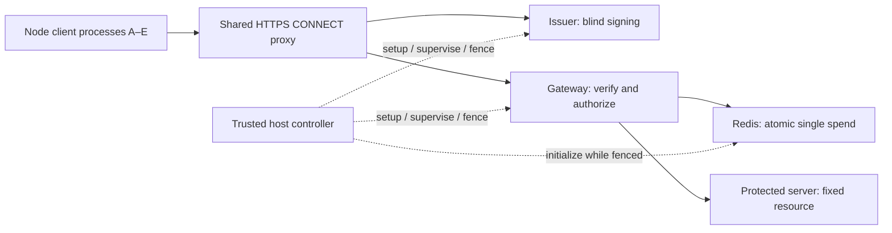

# TokenForge — End-to-End Implementation Plan

**Team:** TokenForge · A3-PS024-TC119

**Members:** Krish Sonpal and Mihir Goswami · Pandit Deendayal Energy University

**Faculty Guide:** Dr. Kaushal Shah

**Problem:** PS-024 — Privacy Pass Token Issuance and Anti-Replay Gateway

**Plan version:** 1.2 - 24 October 2026; source paths mapped under src/, v1.1 security design retained
**Final review:** 24 October 2026 — primary agent and Astra found no further static blockers; baseline ready for Gate 0

**Status:** implementation specification, not a claim that the system is already built.

## 0. Start here: instructions for both agents

Read this document before changing code. It defines the common behavior and who owns each file. Krish's agent owns the gateway, replay correctness, contracts, security tests and repository integration. Mihir's agent owns issuance/client integration, the lab controller, proxy/origin environment, functional demonstration and deployment.

The user will clone the existing repository and give the organizers access. **All paths in the proposed tree are relative to that clone.** Do not initialize a replacement repository, alter ownership/visibility, transfer it again, or assume its default branch is named `main`. Inspect its current files, instructions, remote and branch before implementing. Preserve existing work; map this plan onto the clone through the bootstrap milestone.

The implementation checkout is `D:\aior3\A3-PS024-TC119`; its parent retains the research/artifact files. G0 verified Node 24.22.1/npm 11.19.1 and Docker Desktop Linux Engine 29.2.0/Compose 5.0.2. The original Docker permission error was a sandbox restriction; the daemon is working. Host controller/build/test tooling and container runtime use the selected Node 24 version. The controller runs directly on the host/WSL Linux environment with Docker access, never in a baseline container with a mounted Docker socket.

No deadline is assumed. Work advances through acceptance gates. Before parallel code changes, finish and merge **Gate 0** so both agents start from the same contracts and ownership rules.

**Non-negotiable coordination rules:**

1. Every tracked path has exactly one writer. Read other folders freely; request changes from their owner instead of editing them.
2. No root npm workspace/shared application lockfile. Separate gateway, lab and security-test packages each have their own lockfile and owner.
3. `src/contracts/` is the sole authority for shared encodings, policy, management messages and public result labels. Consumers import/use it; do not copy constants into competing implementations.
4. Both agents run the contract tests. Any externally observable contract change requires an explicit change record and coordinated consumers before merge.
5. Commit small verified milestones and push feature branches regularly. Never commit credentials, live tokens or private keys. Do not bypass tests or overwrite another contributor's changes to make a merge succeed.
6. Folder separation prevents routine shared-file conflicts; it cannot guarantee that arbitrary future Git histories never conflict. Frozen interfaces, current branches and integration gates prevent the more serious problem of code that merges but does not work together.

## 1. What we will build and what we can claim

### 1.1 Map the organizer's three-party explanation to the actual system

For the demonstration, explain **client → verification gateway → protected server**. Privacy Pass also requires a logically separate **issuer** to sign credentials before redemption. Do not delete the issuer or merge its signing secret into the gateway to make the picture have exactly three boxes.



There are two protocol phases: **issuance** obtains the credential; **redemption** presents it to the gateway. Proxy, replay store, private server and controller support these phases. The controller/dashboard is not an extra authorization authority in the public request path.

### 1.2 Requirement-to-evidence map

| PS-024 requirement | Implementation | Evidence for evaluator | Owner |
|---|---|---|---|
| One supported RFC 9578 protocol | Type `0x0002` Blind RSA using the existing pinned library | Independent vectors and real issue/finalize/verify tests | Mihir; Krish cross-checks verification |
| Isolated issuer/origin key material | Issuer-only token-signing secret; separate TLS material; gateway public token-verification key | Public configuration, key-boundary tests, reviewed container/mount layout | Both |
| Issuer, client, verification gateway | Separate runtime processes/containers with frozen interfaces | Complete challenge → issue → redeem flow | Both |
| Single redemption | Exact shared Redis state and atomic deadline/claim script | Sequential and concurrent replay tests across workers | Krish |
| Reject invalid, reused, wrong-context tokens | Strict parser, key check, signature check, configured context, claim | Required negative cases plus unchanged origin-arrival count | Both |
| Shared-proxy test | Five isolated clients; two vouchers/tokens each | Ten healthy first spends, extra replay rejected; observed shared gateway source | Mihir |
| Issuance/redemption latency | Defined timers, real operations, correct B0/B1 comparison | Counts/errors/P50/P95/P99/throughput/resources with conditions | Mihir; Krish instruments gateway |
| Threat/unlinkability analysis | Protocol assumptions and metadata limitations | Updated threat report; no unsupported anonymity score | Krish |
| Metadata-retention analysis | Minimum live state, no routine credential history, diagnostic audit | Configuration checks and sanitized report | Krish, with Mihir implementation |
| Demo/pseudocode/repository/PDF | Reproducible runner and concise documents | Fresh-machine setup, demo recording, release commit and submission assets | Mihir for demo/docs; Krish for release integration |
| ARC optional; no new crypto/IP hiding/guaranteed anonymous quotas | Explicit scope boundaries | Honest proposal/report/demo narration | Both |

### 1.3 Security claim that must remain honest

We will reject forged/modified credentials, genuine wrong-context credentials and second use of an already-claimed credential under the stated trust/time/state assumptions, including a trustworthy non-regressing Redis/host wall clock and no silent replay-state rollback (§6.1). A copied **unused** bearer token can still be spent by its thief first. Single use ensures one winning claim; it does not identify the rightful presenter or prevent voluntary sharing.

Mitigate exposure through validated TLS, memory-only token inventory, no credential logs, restricted networks and bounded context lifetime. Demonstrate the theft limit explicitly. Do not claim “an attacker cannot break anything,” absolute anonymity, exactly-once delivery, anti-Sybil identity, or theft-proof tokens. Adding device/channel binding would require a separate compatible design and privacy analysis; it is not hidden inside this baseline.

## 2. Final design and versions

The official [PS-024](./PS-024.pdf) controls scope. Prompts 4–7, 9 and 10 provide design background. This plan freezes the implementation choices below and fills the integration details. A change must be recorded in a numbered decision, with affected tests and both owners identified.

| Area | Baseline decision |
|---|---|
| Runtime/language | TypeScript, ESM, Node.js 24; Linux containers on Docker Compose |
| Privacy Pass library | `@cloudflare/privacypass-ts` exactly `0.9.0`; published source commit `4edc0e2bf639a60142a3f809d38ce7bd5c6f8c9e` |
| Blind RSA dependency | Published library dependency `@cloudflare/blindrsa-ts` exactly `0.4.5`; do not substitute a newer repository `main` |
| Suite | RFC 9578 Type `0x0002`; RSA-2048, `RSABSSA-SHA384-PSS-Deterministic`, SHA-384/MGF1-SHA-384, 48-byte PSS salt |
| Redis adapter | `ioredis` exactly `6.0.0`; Redis 7.4-compatible single primary |
| Issuance | One 259-byte request and one 256-byte response; no batch endpoint/DLEQ/metadata extension |
| Verification | Gateway public-only token verification; exact 354-byte token; context/replay checks added separately |
| Acceptance | Current 600-second epoch only; spent entry expires at epoch end + 30 seconds |
| Worker configuration | Two gateway processes, two complete active flows each, FIFO 16 per worker, queue wait 100 ms |
| Recovery | Volatile store; fail closed on authorization uncertainty/restart; fully fenced fresh-key/run reset |
| Enrollment | One-use lab vouchers provisioned before enable; five demo clients receive two each |
| Main demo client | Node harness; browser shows sanitized reports, not a new browser Privacy Pass implementation |
| Deployment | Single Linux host; private lab/proxy/management, access through SSH/local screen sharing |

On 23 October the exact npm versions and published dependency metadata above were rechecked. This is not a vulnerability clearance or compatibility test. Gate 0 must run a real-library spike and inspect dependency/license/advisory information. Pin the exact Node patch, TypeScript/build/test versions and image digests in the bootstrap commit. These moving operational pins are not guessed here. An update requires evidence and a decision record; no silent “latest.”

The library supplies crypto/protocol building blocks, not our complete service, admission policy, replay lifecycle or secure deployment. Gateway signature verification alone is insufficient. Standard protocol background: [RFC 9578](https://www.rfc-editor.org/rfc/rfc9578.html), [RFC 9577](https://www.rfc-editor.org/rfc/rfc9577.html). Selected implementation source: [pinned Type 2 module](https://github.com/cloudflare/privacypass-ts/blob/4edc0e2bf639a60142a3f809d38ce7bd5c6f8c9e/src/pub_verif_token.ts).

## 3. Repository layout and exclusive ownership

### 3.1 Proposed tree

```text
<cloned-repository>/
  AGENTS.md                         K: ownership and agent rules
  IMPLEMENTATION_PLAN.md            K: master plan after copying into clone
  IMPLEMENTATION_REVIEW.md          K: review findings and bootstrap acceptance
  KRISH_AGENT_HANDOFF.md             K: bootstrap handoff
  MIHIR_AGENT_HANDOFF.md             K: bootstrap handoff; Mihir's progress elsewhere
  README.md                         K: entry point; links to owner-specific docs
  .gitignore                        K: runtime secrets/artifacts exclusion
  .dockerignore                     K: root-context exclusions
  .editorconfig                     K
  package.json                      K: orchestration scripts only; no workspaces/deps
  config/tsconfig.base.json          K: frozen shared compiler settings
  .github/CODEOWNERS                 K: real verified account handles
  .github/workflows/ci.yml           K: all required checks
  src/contracts/                        K: only shared contract authority
    VERSION
    protocol-v1.json
    schemas/                        manifests, control, reports, scenarios
    lib/                            dependency-free encodings/types/validation
    fixtures/                       public/test-only golden data + provenance
    test/                           golden/negative contract tests
    CHANGELOG.md
  src/services/
    gateway/                        K: independent npm package + package-lock.json
      src/                          admission, verifier, queue, origin, control, workers
      replay/                       claim.lua, snapshot.lua, schema and ACL requirements
      scripts/                      build/check helpers
      test/                         parser, concurrency, state and failure tests
      Dockerfile
      README.md
    lab/                            M: independent npm package + package-lock.json
      src/issuer/                   isolated issuer entry point
      src/client/                   actual Privacy Pass client + scenario fixtures
      src/controller/               trusted host setup/supervision/CLI
      src/origin/                   fixed protected resource + counter
      src/report-ui/                static sanitized-report viewer
      scripts/                      build and CLI launch helpers
      test/                         issuer/client/controller/functional integration
      Dockerfile                    image may have separate role entry points
      README.md
  src/security/                         K: independent npm package + lockfile
    test/                           cross-service adversarial/regression tests
    retention/                      audit checks; safe outputs only
    README.md
  infra/                            M: sole writer
    compose.yaml                    one authoritative complete Compose topology
    proxy/                          Tinyproxy rules
    redis/                          volatile/diagnostic settings; no live credentials
    scripts/                        preflight, CA/secrets provisioning, deployment
    deploy/                         private-host runbook and example config
  scripts/                          K: root CI/ownership checks, no duplicate lab CLI
  docs/
    implementation/                 K: plan, decision records, contract decisions
    src/security/                       K: threat/retention/evaluation assertions
    lab/                            M: setup, issuer/client/infra notes
    demo/                           M: demo narrative and report-viewer use
    submission/                     M: final report/PDF/demo links when prepared
  .runtime/                         ignored: local infra secrets/public run files
  artifacts/                        ignored: generated reports/captures/build output
```

`K` means Krish's agent; `M` means Mihir's agent. No “both own this file” entries. Per-service Dockerfiles are owned by their service owner; Compose and deployment belong to Mihir. Tests belong beside the implementation they check, or in the owner's explicitly assigned test directory. Both can review any PR.

Use one Mihir-owned lab package to reduce dependency/tooling duplication, but **separate issuer, clients and origin into different processes/containers**. Sharing source/build tooling does not permit sharing live secrets or networks. The gateway image must not contain issuer secret material. Known test keys/fixtures must never be live accepted keys or shipped as runtime secret configuration.

### 3.2 Shared code without a shared package-lock

`src/contracts/lib/` contains dependency-free TypeScript: strict types/schema checks, canonical public-manifest encoding, context-input encoding, authenticated-input encoding and spend-ID helpers using Node's standard crypto. It has no service state and no issuer signer. Do not create a new cryptographic primitive.

Each service's build bundles its own entry points plus relative contract imports into `dist/`, while third-party npm packages remain normal service-local locked dependencies. A per-service build tool such as esbuild and strict `tsc --noEmit` may be used; pin tool versions at Gate 0. This avoids a root dependency workspace, file-linked packages and copied contract source. Contract code must not import a service's private source or third-party packages resolved from another service's `node_modules`.

Both service Docker builds use the **repository root as build context**, with the owner's service Dockerfile selected explicitly, because `src/contracts/` is outside either package folder. Compose paths must resolve that root rather than a service-only context. Use explicit COPY paths for the owning package, shared contracts and compiler config; never `COPY . .` into a runtime image. Root `.dockerignore` excludes `.git`, `.runtime`, artifacts, existing recordings/photos/decks, local `node_modules` and other non-build material. Runtime stages copy only their built entry points and production dependencies, excluding tests/known private fixtures and the other service's implementation. Verify a clean root-context build at G0/G1. [Docker build contexts](https://docs.docker.com/build/concepts/context/)

All three packages expose `npm ci`, `npm run typecheck`, `npm test`, `npm run build`. Any package using shared contracts tests the same golden fixtures. Contract test tooling is run through the gateway package's pinned tools; it does not create another root lockfile.

### 3.3 Root integration and change control

Krish bootstraps the root and contracts, then Mihir creates/owns `infra/` and `src/services/lab/`. Root scripts delegate to owned packages. If Mihir needs a CI/root/contract change, he writes a request under `docs/lab/contract-requests/` and Krish implements it; Krish requests lab/infra changes under `docs/implementation/lab-requests/`.

A change request states: current contract version; exact field/behavior change; reason; affected producer/consumer; migration and tests; compatibility impact. Contract changes merge before or with dependent work through a coordinated integration branch. Never amend an already-frozen meaning while retaining the same version and fixtures.

Configure CODEOWNERS/review rules if permitted by the repository's account plan and organizer permissions. If unavailable, enforce the same two-person review convention manually. Neither agent changes organizer access or branch protection without appropriate repository authority. [GitHub protected branches](https://docs.github.com/en/repositories/configuring-branches-and-merges-in-your-repository/managing-protected-branches/about-protected-branches)

## 4. Contract A — Public protocol and shared policy

Gate 0 turns this section into actual strict schemas/helpers/fixtures. Until that commit exists, this is the normative specification; after bootstrap, the versioned `src/contracts/` files implement it. A disagreement must be resolved explicitly, not worked around in one consumer.

Earlier prompt files are design history/reference material. For implementation details refined here—especially script arguments/results, management messages, leases and HTTP error handling—use this reviewed v1.1 plan and then its agreed executable contracts. Do not combine an older Prompt 6 ABI with a newer consumer, or copy old status mappings into one service. G0 records these refinements in the initial contract change log.

### 4.1 Service identities and public endpoints

| Endpoint | Behavior |
|---|---|
| `https://issuer.lab.test/.well-known/private-token-issuer-directory` | RFC directory; public key/configuration only |
| `https://issuer.lab.test/issue` | POST exactly one Type 2 binary request with one-use lab voucher |
| `https://origin.lab.test/resource` | GET only, exact configured authority/path, no query/body; challenge or token redemption |
| `http://protected-origin:8080/resource` | Private fixed GET; ≤16 KiB deterministic body; independent received/generation-mismatch/served aggregate counters |

Issuer/gateway negotiate TLS 1.3 and HTTP/1.1 through CONNECT. Clients validate the lab CA and expected hostname. `rejectUnauthorized=false`, wildcard arbitrary issuer fetching, redirect-based endpoint selection and untrusted authority forwarding are forbidden. No token in URL/query/cookie. No public admin, voucher-provisioning, origin-counter or reset endpoint.

The directory carries `issuer-request-uri` and `token-keys[{token-type:2, token-key:<padded base64url RSA-PSS SPKI>}]`. Full key ID is SHA-256 of the correct encoded public key. Use the library's RSA-PSS SPKI conversion; hashing a generic `rsaEncryption` SPKI instead produces a different identifier. Public directory key encoding includes RFC-required padding, even though our separate local voucher encoding does not.

### 4.2 Exact wire data

```text
TokenRequest = U16(0x0002) || U8(truncated_token_key_id) || blinded_msg[256]
  total 259 bytes; truncated ID is the last byte of the full key ID
TokenResponse = blind_sig[256]
  total 256 bytes
AuthenticatorInput = U16(0x0002) || nonce[32] || challenge_digest[32] || token_key_id[32]
  total 98 bytes
Token = AuthenticatorInput || authenticator[256]
  total 354 bytes
```

Issuer request/response content types are `application/private-token-request` and `application/private-token-response`. Use existing library serialization/finalization and independent conformance fixtures. Wrappers enforce exact lengths/trailing-byte rejection before permissive library parsers. Each outstanding issuance has a fresh library Client instance and private pending state; nonce alone is not the complete input to blind.

The issuance-only lab admission header is `X-Lab-Voucher: <base64url of 32 random bytes, no padding>`, exactly one field/value of 43 ASCII characters with canonical pad bits. This is our enrollment wrapper, not an RFC Privacy Pass field. Generate vouchers using the OS CSPRNG. The issuer retains only `SHA256(ASCII("PS024-voucher-v1") || voucher_bytes)` in its preprovisioned set; remove a valid digest atomically before starting signing. Signing failure/uncertainty consumes that attempt; never reinsert it. Unknown/reused/invalid vouchers return a fixed generic **403** `issuance-not-authorized`. Malformed HTTP framing returns 400; unsupported token type, mismatching truncated key ID or wrong blinded-message size in a bounded, complete request returns **422** `issuance-request-invalid` per RFC 9578 §6.2. Reject the latter before consuming a voucher. A successfully parsed request whose BlindSign operation fails does not refund the consumed voucher; use a fixed safe failure result, never an exception dump. Internal unavailability returns 503. Wrong media type is 415. Distinguish the **4096-byte transport body cap** from the **259-byte valid protocol size**: a complete 258/260-byte body within the cap gets 422, whereas a declared/received body above 4096 may be rejected as 413 without buffering it. Excessive headers may get 431 or transport closure. Require unambiguous Content-Length for this controlled HTTP/1.1 issuance client; reject Transfer-Encoding/ambiguous framing with 400. Gate 0 freezes these response bodies/ordering and boundary tests. Prohibit duplicate voucher headers and remove this header from any forwarded protected request. [RFC 9578 §6.2](https://www.rfc-editor.org/rfc/rfc9578.html#section-6.2)

Redemption uses one unambiguous `Authorization: PrivateToken token="<base64url>"`. A missing token yields 401 with `WWW-Authenticate: PrivateToken challenge="...", token-key="..."`. Follow the RFC's base64url padding and unknown-auth-parameter rules; reject duplicate known fields/ambiguous credentials. Gateway responses/resource policy use `Cache-Control: no-store`; no reusable clearance cookie or cache bypasses a new token decision.

### 4.3 Canonical context and spend identity

```text
epoch = floor((redis_now_ms - run_start_ms) / 600000)
epoch_start_ms = run_start_ms + epoch * 600000
epoch_end_ms = epoch_start_ms + 600000
  negative offsets are invalid, not a usable negative epoch

redemption_context = SHA256(
  ASCII("PS024-context-v1") || U16(0x0002) || run_id[16] || token_key_id[32]
  || U64(epoch) || U64(epoch_start_ms) || U64(epoch_end_ms)
  || LP("issuer.lab.test") || LP("origin.lab.test") || LP("GET /resource")
)
LP(s) = U16(byte_length(s)) || ASCII(s)
TokenChallenge fields:
  token_type = 0x0002
  issuer_name = issuer.lab.test
  redemption_context = above 32 bytes
  origin_info = origin.lab.test
challenge_digest = SHA256(library_RFC_serialize(TokenChallenge))
spend_id = SHA256(ASCII("PS024-spend-v1") || serialized AuthenticatorInput)
spent_key = "pp:spent:" || lower_hex(spend_id)
```

Integers are unsigned big-endian; manifests use safe nonnegative integer millisecond values, never floating-point seconds. Golden fixtures must distinguish hashing serialized RFC challenge bytes from JSON. All clients share the same run/key/epoch/scope context; do not add account/client/voucher identifiers. Future contexts can be predictable: validity does not prove issuance during that epoch.

### 4.4 Public run manifest and configuration digest

Freeze these required public fields in `src/contracts/schemas/run-manifest-v1.json`:

```json
{
  "schema_version": 1,
  "contract_version": "TF-PS024-1.0.0",
  "run_id": "<32 lowercase hex characters>",
  "policy_version": 1,
  "run_start_ms": 0,
  "epoch_ms": 600000,
  "guard_ms": 30000,
  "token_type": 2,
  "token_key_id": "<64 lowercase hex characters>",
  "token_key_spki_b64url": "<public RSA-PSS SPKI>",
  "issuer_name": "issuer.lab.test",
  "origin_name": "origin.lab.test",
  "resource_scope": "GET /resource",
  "issuer_request_uri": "https://issuer.lab.test/issue",
  "snapshot_script_sha1": "<40 lowercase hex characters>",
  "claim_script_sha1": "<40 lowercase hex characters>",
  "gateway_profile": "B1",
  "limits": "<strict object of section 7 settings; not a free-form string>"
}
```

This is a shape illustration, not a runnable manifest; `limits` must be a typed object in Gate 0, and zero here is not permission to start with an invalid timestamp. Include fixed internal origin/store endpoint names, expected role-network listeners and any non-secret operational values needed to prevent configuration drift in the strict schema. Never embed passwords, vouchers, private keys or tokens.

`config_digest = SHA256(UTF8(canonical_json(public_manifest)))`, lowercase hex. Contract helper canonicalizes schema-valid JSON with recursively sorted ASCII object keys, ordered arrays, ASCII strings and safe integers/booleans/null; reject unknown fields and unsupported values. This is a restricted application encoding, not a claim to implement every aspect of RFC 8785. Do not include `config_digest` in its own hash. Both owners must reproduce the same fixture.

The manifest digest is a control/configuration consistency check; it does not replace the canonical context, signature, trusted provisioning or secret credentials. Store policy fields plus expected digest in `pp:policy`; runtime workers must verify the active manifest/policy correspondence.

### 4.5 Golden fixtures and version checks

Krish supplies public/test-only fixtures containing: source provenance, RSA-PSS SPKI bytes, full/truncated key ID, fixed run/epoch/scope values, canonical context input/output, serialized challenge/digest, fixed nonce/authenticated input/spend ID, and exact expected lengths. Add independent RFC vectors for crypto compatibility; a client verifying its own output through the same mistaken wrapper is insufficient.

Mihir reproduces the shared-policy results independently once before relying on shared helpers, then both consumers run the golden suite. Fixed randomness is permitted only in isolated unit/vector tests, never a deployed configuration flag. Test keys are clearly labeled and are never the fresh live issuer key. Record contract version and source commit in every built image/report; PREPARE must reject mismatches.

## 5. Contract B — Management, readiness, supervision and reset

**This is the highest-risk integration boundary.** Mihir owns the controller; Krish owns the gateway's lifecycle enforcement. Both implement the following schema and state machine. Public protocol success must not depend on an undocumented private function in the other owner's code.

### 5.1 Local transport and message envelope

Each role has an application-private `/run/ps024/control.sock`, directory mode 0700/socket 0600, owned by its application UID. No shared socket mount, public TCP admin endpoint or container Docker socket. A controller-invoked helper connects inside the target container. Secrets travel via private stdin/control messages, never command-line arguments, console dumps or persistent control transcripts.

Newline-delimited UTF-8 JSON; maximum message 65536 bytes; strict schema; request/reply IDs must match. A persistent helper connection may carry commands/heartbeats. Helpers return structured messages, never echo submitted payloads. Fixed errors do not stringify a request or Redis command.

Commands are dispatched asynchronously with responses correlated by request ID; do not assume response order. Allow at most one running scenario per client, at most eight ordinary pending control requests per connection, and a reserved stop path for FENCE. A long `RUN_SCENARIO` response may remain pending, but STATUS/REPORT/FENCE must remain responsive on the role's control listener. FENCE cancels the scenario and then satisfies the strong barrier; it must not wait in a FIFO behind scenario completion. The controller uses independent role I/O and nonblocking child processes, so awaiting a scenario never blocks issuer/gateway heartbeats or Docker monitoring. Test this with a deliberately stalled scenario and an in-flight FENCE.

```json
{
  "version": 1,
  "request_id": "<fresh 32-hex ID>",
  "command": "PREPARE_RUN",
  "run_id": "<32-hex ID or null only where allowed>",
  "config_digest": "<64-hex digest or null only where allowed>",
  "target_incarnation": "<discovered process-incarnation ID>",
  "payload": {}
}
```

Reply fields: `{version, request_id, ok, result, state, run_id, config_digest, incarnation, data}`. `incarnation` is fresh at process start, not the reusable container/service name. Fixed error results: `BAD_VERSION`, `BAD_MESSAGE`, `WRONG_RUN`, `WRONG_CONFIG`, `WRONG_INCARNATION`, `ILLEGAL_STATE`, `DEPENDENCY_UNAVAILABLE`, `FAULTED`; details must be allowlisted/non-secret.

`STATUS` discovers state/incarnation and can use null run/config/target on initial discovery. `FENCE` is an idempotent privileged stop command and may deliberately fence the current service even if the caller's remembered run is stale; its response identifies what was fenced. All other mutations require the discovered target incarnation. `CREATE_ISSUER_KEY` and the issuer's initial `PREPARE_RUN` use `config_digest=null` in the envelope because no old prepared digest exists; PREPARE carries the new manifest and its proposed digest in the payload, validates them, and returns the accepted digest. Initial PREPARE for other fresh roles follows the same null-current-digest rule. Later commands require the accepted digest. No silent key generation, reset or voucher replenishment on a retry.

### 5.2 State machine and commands

```text
FENCED -> PREPARED -> READY -> ENABLED -> CLOSING -> FENCED
                         any unsafe event -> FAULTED
FAULTED cannot re-enable the same run
```

`READY` means dependencies/configuration have been validated, not that public admission has started. Configuration/credential provisioning is allowed only before enable while fenced/preparing. `FENCE` does not delete security state. Only controller teardown after the barrier may discard it. Preserve a terminal `run_closed` latch and run ID even after state becomes FENCED; FENCED alone must never permit preparing/enabling the same closed run again. A new run requires the controller's full reset with fresh key/incarnations, except the explicitly quarantined security-client fixture described in §9.3.

| Command / target | Required behavior and output |
|---|---|
| `CREATE_ISSUER_KEY` → issuer | New run ID while FENCED; generate dedicated key internally; return correctly encoded public SPKI/full key ID only. Exact duplicate request may return the same in-memory result; never generate another key silently |
| `PREPARE_RUN` → issuer/gateway/origin/clients | Validate immutable public manifest and role-specific endpoints/secret references; retain only what that role needs. Issuer confirms manifest matches its generated key |
| `PROVISION_VOUCHERS` → issuer | Digest-only batches, maximum 128 per message, before enable; reject duplicate/re-added digests/provisioning after enable. Entire scenario inventory prepared in advance |
| `PROVISION_CLIENT` → each client | Its own plaintext vouchers/public configuration via local private transfer; maximum 128 vouchers/message; no other client's inventory or secret-bearing acknowledgement; same bounded completion protocol below |
| `CHECK_READY` → issuer/gateway/origin/clients | Validate prepared state. Gateway requires exactly the profile's configured workers, with every worker's key import, expected Redis policy/guards/config digest/script availability and pools ready; report READY only after all checks |
| `ENABLE` → issuer/origin/clients/gateway | Exact prepared run/config/incarnation; gateway enabled last. Repeat ENABLE for the same active immutable state may acknowledge, not mutate |
| `HEARTBEAT` → issuer and gateway | Matches active run/config/incarnation; renew controller-supervision lease only while active; never clear a fault latch |
| `FENCE` → all serving components | Stop new work, cancel queues, abort active transports, suppress late callbacks, close role connections; return strong FENCED acknowledgement only when barrier conditions are met |
| `STATUS` → any role | State/run/config/incarnation/readiness/fixed fault reason only; no credential material |
| `REPORT` → any role | Section 9's allowlisted counters/histograms and origin aggregate count; no raw request/event history |
| `RUN_SCENARIO` → client harness | Named frozen scenario, cohort/profile/seed for scheduling only; protocol randomness remains genuine; returns sanitized assertions/results, not token inventory |

No `EXPORT_TOKEN`, `EXPORT_SIGNING_KEY`, arbitrary `EVAL`, arbitrary upstream URL or public reset operation. Cross-client theft/replay fixtures execute inside the trusted harness with disposable in-memory credentials, not through a new public administrative feature.

Both provisioning commands carry `{batch_id, batch_index, expected_total, final_batch, items}` in their role-specific strict payload, with at most 128 items and the overall 65536-byte limit. Before enable, the receiver tracks monotonically increasing batch indices, total received and duplicate items/digests in memory; reject duplicate/replayed batches instead of restoring inventory. `final_batch=true` seals provisioning only when the expected total is reached; CHECK_READY requires that seal. The issuer's total equals the sum of client inventories. Ambiguous provisioning aborts the run rather than retrying/refilling. Freeze a per-profile maximum total inventory and verify its memory budget at G0; do not accept an unbounded caller-provided total. Public reports carry counts only, never batch contents.

### 5.3 Controller-loss detection refinement

Earlier proposals required ongoing supervision but did not fully specify controller-loss detection. Implement this explicit operational refinement: controller sends authenticated local heartbeats every 1 second to issuer/gateway through persistent helpers; each locally measures freshness using a monotonic timer, with an initial 3-second maximum lease. Missing lease closes public admission and latches the run faulted. Tuning requires a recorded change and both consumers/tests.

**Worker enforcement is mandatory.** Each gateway worker checks its own unexpired monotonic lease before admission, at promotion and immediately before forwarding. A supervisor-only timeout is insufficient: a paused supervisor must not leave workers serving. Check expiration synchronously **before renewing** any lease, rather than relying on the timeout callback running first. A late heartbeat cannot revive an expired run. Forwarded heartbeats carry the original gateway-local monotonic expiry, not a new three-second duration measured when the worker finally receives IPC. Use a confirmed common OS monotonic clock across the supervisor/workers in the same container; freeze/test its representation at G0. Issuer uses the same expiration-before-renewal rule locally. No cross-host clock comparison is assumed.

Each controller/helper link allows only one heartbeat outstanding, with increasing sequence numbers bound to the run/incarnation; stale/duplicate replies cannot renew anything. Do not accumulate heartbeats in an offline/retry queue. Test supervisor pause, delayed IPC, a heartbeat processed after expiry but before a delayed timer callback, and controller/helper loss. Lease expiry latches closure until a fresh fenced run.

Initial ENABLE is the sole operation allowed to install an initial three-second lease for that newly prepared run. It installs the deadline in all configured workers before opening admission, returns their acknowledgements, and then periodic heartbeats renew it. Repeat ENABLE never refreshes a deadline or reopens a closed run. Keep servicing issuer heartbeats while waiting for gateway readiness/enable; a slow next-role operation is not permission to omit supervision. If enable/ack takes too long, fence/reset rather than renew an already expired lease.

Docker event monitoring continuously detects relevant process/container exits or incarnation changes. `restart: "no"`; no same-run worker respawn or connection-driven auto-recovery. Controller event-stream/helper loss is unsafe, not a reason to keep serving indefinitely. A replacement controller first fences/kills old processes and confirms exit; it cannot renew an expired run into service.

This gives bounded detection under healthy scheduling, not instantaneous revocation or a production consensus protocol. Already-authorized work may have begun; teardown/reset must still wait for the barrier. Deliberately test controller/helper loss and delayed event delivery. Controller monitoring overhead must be recorded in benchmarks.

### 5.4 Startup order

1. Start Docker role containers in FENCED mode and Redis with no active run; no host-visible protected service.
2. Controller discovers incarnations and confirms no old workers/connections are serving.
3. Allocate fresh run ID; issuer creates a fresh signing key and returns public material.
4. Controller reads Redis `TIME` for `run_start_ms`; uses Krish's schema/bootstrap requirements to install immutable `pp:policy`, existing `pp:clock`, load the exact scripts and set minimal ACLs while fenced. Compute public manifest/config digest consistently after public key/script SHAs/settings are known; store the matching digest with policy.
5. PREPARE all roles. Provision whole demo/benchmark voucher cohort and distribute each client's own inventory. Keep plaintext voucher mapping only as long as test setup needs it.
6. CHECK_READY all roles; verify contract/config/incarnations. Issuer key must still be the one used by the manifest.
7. Enable issuer/origin/clients, establish supervision heartbeats, then enable gateway last. An issuer READY endpoint alone is not overall readiness.
8. Controller remains running while scenario/benchmark/demo executes. On any unsafe dependency or supervision event, initiate closure.

### 5.5 Strong reset barrier

For intentional stop or fault, stop admitting first and broadcast FENCE. Gateway supervisor closes admission, removes queued jobs, prevents any late verify/Redis callback from authorizing another forward, aborts upstream/downstream work, closes pools/sockets and waits for active work to settle. A worker that cannot acknowledge is terminated.

Controller waits for **strong FENCED acknowledgements** from all old serving workers, or kills the relevant container/process tree and confirms exit. Use a bounded local control wait (initial 10 seconds); timeout means kill-and-confirm, not assume success. A hung process/native promise may require process termination. Failure to confirm old processes are gone means remain closed.

Only after that barrier: stop/discard old Redis process/state; remove old accepted public key/cache; end old issuer process/key; clear client inventory; generate fresh run/key and initialize fresh guards/scripts/vouchers. Never flush Redis while old gateway workers can still claim. No late callback from an old generation may touch a new generation's store/origin.

The origin participates in the barrier too: stop accepting, close listener/existing sockets, settle/abort handlers, then recreate its process/counters for the next run. Abort at the gateway does not undo bytes already delivered to the origin. Require its strong acknowledgement or kill-and-confirm exit. Old-run reports snapshot settled counts before destruction; never reuse an old count as a new run's baseline. If a forced kill prevents obtaining the settled counter, report it as **unavailable/INCONCLUSIVE**, not zero. Gateway injects an internal `X-TokenForge-Run` header containing its prepared run ID; origin requires the matching enabled run and refuses a mismatch before serving the protected resource. Strip all client-supplied `X-TokenForge-*` headers first. This is generation attribution within a trusted private network, not a replacement for token authorization or a secret authentication scheme.

Maintain three independent origin counters: `protected_requests_received`, `generation_mismatches`, and `resources_served`. Increment **received before generation validation** for every fully parsed request targeting the protected route, including wrong/missing generation headers; count mismatches separately, and increment served only when the resource is actually served. Throughout this plan, “origin arrival” means **received**, not served. No-forwarding assertions require unchanged received count; served=0 alone cannot prove the gateway did not forward. Component tests deliberately submit a wrong-generation request and require received +1, mismatches +1, served +0. Reports bind counters to the origin process incarnation/run and retain aggregate deltas only.

**Ambiguous control mutation:** if key creation/provisioning/enable cannot be confirmed, close and redo fresh setup; do not invent exactly-once administrative behavior. STATUS can clarify fixed state, but live voucher replenishment and automatic mutating retries are forbidden. Controllers must not race each other; one trusted controller owns one Compose project/run, protected by a local exclusive process lock.

## 6. Contract C — Replay Store and gateway decision

### 6.1 Redis schema and script calls

One dedicated store, one active run, one primary; no AOF/RDB/replicas/backups/failover. `maxmemory=268435456`, `noeviction`, initial container limit 384 MiB, 70% warning. Keep policy/clock non-expiring for the run. Live guard loss is fatal, never repaired by workers.

**Security precondition restored from Prompt 4 §5.3 and Prompt 9:** Redis/host wall time is trustworthy and non-regressing, and accepted replay state is not silently rolled back/restored. Redis absolute expiration plus a 30-second guard is not protection against arbitrary wall-clock rollback. Example outside the guarantee: a spent key expires during a forward time excursion, time then returns to the old epoch before another claim observes the excursion, and the old highwater cannot prove deletion occurred. Even polling cannot rule out every between-observation excursion. Monotonic controller leases do not repair that wall-clock problem.

Detected backward time against recorded highwater, observed unsafe time jumps, VM/store restoration or uncertain continuity requires closure and a trustworthy-clock full reset, not an automatic same-key recovery. Do not run host-clock manipulation or VM snapshot restoration during normal service. S17 tests **detected regressions against recorded state**, not arbitrary rollback resistance. If that stronger requirement is later introduced, stop and review a changed design, such as non-expiring run-wide spent records with a fixed voucher cap and monotonic hard run lifetime/fresh-key reset; update retention and tests. Do not silently claim the current TTL design already supplies it.

| Key | Value |
|---|---|
| `pp:policy` | HASH, exact fields below; immutable public policy/run/key/config values from the manifest |
| `pp:clock` | HASH, exact fields below; existing run guard, last observed authoritative claim time, highest epoch, closed state |
| `pp:spent:<64-lower-hex>` | String `1`, absolute expiry `epoch_end_ms + 30000` |

`pp:policy` HASH fields are exactly `schema_version`, `run_id`, `token_type`, `token_key_id`, `config_digest`, `run_start_ms`, `epoch_ms`, `guard_ms`. `schema_version=1`, `token_type=2`, `epoch_ms=600000`, `guard_ms=30000`. `pp:clock` HASH fields are exactly `run_id`, `last_now_ms`, `highest_epoch`, `closed`, initialized to the new run ID, `run_start_ms`, `0`, `0`. IDs/digests use the manifest's lowercase hex lengths. All numeric HASH values are canonical unsigned decimal ASCII strings (no sign, whitespace, exponent or unnecessary leading zeros); `closed` is exactly `0` or `1`. Reject wrong Redis types, unexpected/missing fields, invalid encodings and unsafe arithmetic; derived timestamps must be safe integers ≤9007199254740991 and epoch/time must be consistent with recorded highwater. Both HASH keys have no TTL. Spent keys must have the expected string value and deadline; an unexpected existing representation is unsafe, not an ordinary replay.

Bootstrap/readiness reads and compares **all policy fields** with the trusted manifest, validates their computed digest association and checks the initial guard. A stored digest beside corrupted fields is not proof that those fields match. Scripts validate the critical numeric constants/run/key/digest and all time/guard relationships they use; immutable policy may not be edited during a run. G0 supplies exact bootstrap/validation fixtures and a field/type corruption test matrix.

Krish's snapshot script:

```text
EVALSHA <snapshot_sha1> 2 pp:policy pp:clock
  <expected_run_hex> <expected_key_hex> <expected_config_digest_hex>
-> ["SNAPSHOT", run_hex, key_hex, config_digest_hex, now_ms, epoch, epoch_start_ms, epoch_end_ms]
```

Read-only in behavior; ordinary EVALSHA, not an assumed `EVALSHA_RO` setup. Read stored policy/guard and Redis TIME; reject unsafe/missing/closed/mismatched state; allocate no token state, do not update highwater. Error result `RUN_UNAVAILABLE` or `CLOCK_UNSAFE`.

Krish's atomic claim script:

```text
EVALSHA <claim_sha1> 3 pp:policy pp:clock pp:spent:<digest_hex>
  <expected_run_hex> <expected_key_hex> <expected_config_digest_hex> <candidate_epoch> <digest_hex>
```

Validate required field types/presence, active run/full key/**expected configuration digest**, closed/clock guard, stored/current time bookkeeping, lower-hex spend digest and exact key-prefix correspondence. Snapshot also checks the expected digest and the adapter validates its echoed identity/digest. Any mismatch returns `["RUN_UNAVAILABLE"]` and closes the run. Candidate epoch is checked against current Redis-derived epoch; caller timestamps/expiry are not authoritative. Derive bounds from policy and execute inside the same script:

```text
SET pp:spent:<digest_hex> 1 NX PXAT <epoch_end_ms + 30000>
```

All script returns are tagged arrays: `["CLAIMED", absolute_expiry_ms]` on success; `["ALREADY_SPENT"]`, `["EPOCH_CLOSED"]`, `["RUN_UNAVAILABLE"]` or `["CLOCK_UNSAFE"]` otherwise. Snapshot errors use the same one-element tagged-array convention. Numeric timestamp/epoch fields are integer RESP values; IDs/tags are strings; no null/boolean/error reply is a valid result. Typed adapter rejects unexpected length/type/tag and must not interpret any truthy array as success. Successful NX insertion is the single-spend linearization point; no separate GET+SET or non-atomic front-time check. Script SHA-1 is Redis's script identifier, distinct from token/context SHA-256. [Redis EVALSHA](https://redis.io/docs/latest/commands/evalsha/), [SET](https://redis.io/docs/latest/commands/set/)

The internal script must validate everything that can fail before mutating state. Redis Lua gives atomic execution, **not transaction rollback after a runtime error**. A script error/failed allocation after partial guard updates is unsafe; close the run. The script must never manufacture missing guards. Cross-run namespace separation relies on the dedicated fenced store and signed context, not a caller-selected run namespace.

Mihir owns Redis configuration/bootstrap invocation, but must consume these script files and schema unchanged. Krish supplies minimal ACL-command/key requirements including the script-internal commands and necessary pinned-client handshake. Controller alone loads scripts/administers ACLs/initializes policy. Gateway cannot CONFIG/FLUSH/SCRIPT LOAD/ACL-administer; allowed write privileges are still sensitive and do not protect against a compromised gateway.

### 6.2 Gateway sequence and HTTP outcomes

Before crypto, check run/lease latch, trusted authority/route/method, bounded transport/framing and queue admission. Missing token obtains a current shared challenge through snapshot. With a token: strict parse/type/full-key ID → public RSA-PSS verification → authoritative snapshot and configured current challenge digest → canonical spend ID → atomic claim → recheck worker lease/open latch → one sanitized fixed-origin attempt. The claim repeats authoritative time/context checks atomically; a preceding snapshot cannot authorize a token across a boundary by itself.

| Condition | HTTP/result |
|---|---|
| Missing token, valid run | 401 `token-required` + current shared challenge/public key |
| Malformed/duplicate/trailing/incorrect-length credential | 400 `token-malformed` |
| Unsupported type | 401 `token-type-unsupported` |
| Unknown full key ID | 401 `token-key-unknown`; no network fetch |
| Bad signature | 401 `token-invalid` |
| Signed but wrong/stale configured digest | 401 `token-context-mismatch` |
| Claim finds boundary closed | 401 `token-expired` |
| Existing spend | 401 `token-already-redeemed` |
| Full/expired queue before promotion/claim | 503 `gateway-busy`; no spend |
| Unsafe/unavailable/uncertain authorization state | 503 `authorization-unavailable`; latch/close as required |
| Confirmed claim and healthy origin | 200 fixed resource |
| Upstream failure after claim | 502/504 if response uncommitted, otherwise close partial transport; no refund/retry |

Every gateway **401**, including unsupported type, unknown key, bad signature, wrong context, expiry and replay, includes a valid current `WWW-Authenticate: PrivateToken challenge="...", token-key="..."` built from authoritative safe state. Obtain a fresh snapshot for this response path; if that fails or the run/lease closed, send 503 `authorization-unavailable` instead of a challenge-less 401. Missing-token and error paths remain subject to the same admission/resource limits. A client does not automatically retry the same credential after a challenge. Test all 401 branches for header presence, padded encoding and valid challenge bytes. [RFC 9110 §11.6.1](https://www.rfc-editor.org/rfc/rfc9110.html#section-11.6.1)

Freeze local rejection body as `{ "error": "<fixed-label>" }`, UTF-8 JSON, no internal diagnostics/echoed fields; all relevant gateway responses no-store. These labels are lab API choices, not RFC-mandated error names. Before claim, reject an unknown authority with 421 `authority-not-allowed`, an unexpected path/query with 404 `resource-not-found`, a non-GET method with 405 `method-not-allowed` and `Allow: GET`, and forbidden body/ambiguous framing with 400 `request-malformed`. Transport-level TLS/HTTP parse failures may close the connection without a JSON response. Freeze ordering for overlapping violations in Gate 0 and test it.

Strip authorization, voucher, cookies, client verification flags, forwarded client identity and arbitrary destination headers before origin. Permit only the fixed GET resource and minimal allowlisted headers, with the gateway-generated run header from §5.5. The protected server increments its **received** counter before generation validation, independently of gateway/client success messages; mismatch and served counters stay separate. No protected-resource cache bypasses authorization.

## 7. Frozen resource, transport and diagnostic settings

| Setting | B1 default |
|---|---|
| Gateway | Supervisor plus 2 workers; each worker 2 active full protected-request flows |
| Queue | FIFO 16/worker, 100 ms monotonic wait; remove disconnected jobs and recheck at promotion |
| Socket/framing | 64 gateway sockets/worker, 128 total; headers ≤8192 bytes/32 count; forbid GET bodies/Transfer-Encoding; exact token length |
| Deadlines | TLS/headers 2 s; request completion 5 s; actual abort/close and backpressure |
| Redis | 2 persistent connections/worker; 1 awaited RPC per connection; connect 1000 ms, command 250 ms |
| ioredis safety | `enableOfflineQueue=false`, `autoResendUnfulfilledCommands=false`, `maxRetriesPerRequest=0`, `retryStrategy=()=>null`, `reconnectOnError=()=>false`, `enableAutoPipelining=false` |
| Missing script | Unexpected NOSCRIPT closes run; no live script reload/resubmission |
| Origin pool | 2 total/per-origin/free sockets per worker, keep-alive enabled, explicit free idle lifetime 15 s; origin keep-alive 20 s |
| Origin operation | Absolute 2 s across connect/headers/body with actual abort; ≤16 KiB body; no retry |
| Demo clients | At most 2 sockets per destination/client process |
| Security race harness | Dedicated profile, at most 24 gateway sockets and 2 issuer sockets; still uses unchanged B1 gateway limits |
| Benchmark harness | Separate declared profile: up to 100 gateway/4 issuer sockets; adequate preprovisioned vouchers; no batch wire API |
| Logs/diagnostics | No raw token/voucher/blinded transcript/IP/per-request timestamp logs; no success-token cache |

An active flow holds its permit until completion or actual abort. A 250 ms Redis timeout cannot undo a claim that already committed. The local queue deadline applies before promotion/claim, not as a promise that an uncertain spent token remains unspent. Native async crypto is not evidence of linear throughput scaling.

**Complete B0 differences:** one worker, one active flow, FIFO 16/100 ms, 64 total gateway sockets, one persistent Redis connection/one RPC slot, and one origin total/per-origin/free socket. All protocol, security, timeout, memory, pool-idle, framing, supervision and no-retry settings remain identical to B1. The manifest records actual counts instead of assuming B1. G2 may run this one-worker configuration; readiness requires all configured workers, not an unconditional count of two. Issuer baseline: 2 active signing operations, FIFO 16/100 ms, 32 sockets, 8192-byte/32 headers, 4096-byte transport body cap with exactly 259-byte valid protocol payload, 2-second header/TLS deadline and 5-second request deadline; hold permits until signing actually settles or terminate the issuer on irrecoverable closure. Both B0/B1 use those same issuer bounds.

Mihir configures Redis diagnostic retention per Prompt 10: slow log disabled/length zero, ACL retained log length zero, latency-monitor event history disabled, keyspace notifications empty; no MONITOR subscriber/export. Docker-managed data-path logs use `none`; independently suppress app/proxy file/syslog sinks. Use local fixed status/fault counters for operations. Record the diagnostic tradeoff; do not claim this is a general production logging policy. Audit host dumps/swap/VM snapshots and credential files separately; logical expiry is not forensic erasure.

## 8. Network and deployment contract

Mihir owns a single `infra/compose.yaml` with these exclusive role memberships. Krish reviews the resulting reachability tests; Dockerfile edits remain service-owned.

| Network / planned subnet | Members | Listener binding |
|---|---|---|
| `client_proxy` / `172.28.10.0/24` | Clients A–E, proxy | Proxy `.2:8888`; clients no inbound app TCP |
| `proxy_issuer` / `172.28.20.0/24` | Proxy, issuer | Issuer `.10:443`, alias `issuer.lab.test` |
| `proxy_gateway` / `172.28.30.0/24` | Proxy, gateway | Gateway `.10:443`, alias `origin.lab.test` |
| `gateway_replay` / `172.28.40.0/24` | Gateway, Redis | Redis `.10:6379` plus its own local admin path |
| `gateway_origin` / `172.28.50.0/24` | Gateway, protected origin | Origin `.10:8080` |

Check subnet conflicts before use; changing infrastructure addresses requires updating one agreed manifest/Compose configuration and tests, not protocol-name changes. All bridges explicitly internal; no implicit default network, host networking, privileged containers or container Docker socket. Disable IPv6 allocation and IPv4/IPv6 forwarding in multihomed containers; minimize capabilities, allowing only required low-port binding. Bind listeners to specified interfaces; Compose `expose` is not firewall enforcement.

Tinyproxy destination restriction must include exact hostnames **and** port 443. Source-client ACL, ConnectPort and destination hostname filtering are separate controls. Reject raw IPs, alternate ports, lookalike names and other proxy modes. It tunnels TLS without decrypting credentials. Proxy/client cannot reach private origin/Redis. Internal RESP2 and gateway-origin HTTP are plaintext within a trusted host/network boundary; do not describe them as protected from host/root capture. [Docker Compose networking](https://docs.docker.com/compose/how-tos/networking/)

Health listeners: role-local `127.0.0.1:9091` only, never published. Local control sockets are private to each container. Secrets are generated at setup; token private key never leaves issuer memory. Restricted infrastructure TLS/CA/Redis credentials may use ignored `.runtime/` files mounted only into roles that need them; never embed secrets in images, environment/labels, Git or report output. Plain lab vouchers transfer through private stdin/control and stay in memory.

No issuer/gateway/Redis/private-origin public host ports. Optional proxy mapping is `127.0.0.1:8888` only, verified on the chosen runtime. A read-only report viewer may listen on host loopback `127.0.0.1:4173`. If publishing a port from an internal network does not behave as required on the platform, stop and fix the explicit networking design; do not silently publish all services or add an insecure default bridge.

## 9. Contract D: runner, scenarios and evidence

### 9.1 One supervised command owns a run

Mihir implements these commands in `src/services/lab`. The following are target interfaces to implement, **not commands that already work**:

```powershell
npm --prefix src/services/lab run lab -- preflight
npm --prefix src/services/lab run lab -- run --profile demo --scenario demo-suite --out artifacts/demo-report.json
npm --prefix src/services/lab run lab -- run --profile demo --scenario interactive-demo --out artifacts/live-report.json
npm --prefix src/services/lab run lab -- run --profile security --scenario security-suite --out artifacts/security-report.json
npm --prefix src/services/lab run lab -- run --profile benchmark --scenario benchmark-suite --out artifacts/benchmark-report.json
npm --prefix src/services/lab run lab -- verify-report --file artifacts/demo-report.json
npm --prefix src/services/lab run lab -- serve-report --file artifacts/demo-report.json --host 127.0.0.1 --port 4173
```

`preflight` checks runtime versions, Docker access/Linux containers, Compose, available ports/subnets, dependency installation, contract versions, image pins and local secret permissions. It reports actionable failures without printing credentials. A Windows machine may use Docker Desktop/WSL2, but final integration and deployment must pass on Linux too.

`run` remains a **foreground supervisor**, holds an exclusive project lock, creates and supervises the roles, executes named scenarios, writes validated reports, and fences/cleans up in `finally`. It must not start services and exit while they remain authorized. Interactive mode pauses for local terminal input between named cases while supervision/heartbeats continue. It provides no web control API. A suite may contain multiple independent fresh runs: each gets a new key/run ID and its own evidence, and the preceding run must be fully fenced first.

Signal/exception handling fences the data path before ordinary teardown. If the controller crashes without running cleanup, role leases close admission; the next controller still fences or kills and confirms all old workers before resetting anything. Implement a documented emergency local `lab fence --project <name>` operation that acquires the exclusive lock or first confirms the previous controller is gone. Never interpret a stale lock file alone as permission to reset live state. Project names must be validated, not interpolated into shell commands.

Write live report snapshots by atomic file replacement. The read-only viewer reads only a schema-validated report file, escapes content, loads no remote analytics/CDN assets, and exposes no upload, terminal, arbitrary file-read, scenario execution or Docker endpoint. It can show progress during a run; a completed report remains viewable after all roles stop.

### 9.2 Report schema and privacy boundary

Krish freezes `src/contracts/schemas/report-v1.schema.json` before Mihir builds the UI. Minimum structure:

| Field | Meaning |
|---|---|
| `schema_version`, `contract_version`, `suite_id` | Versioned report and locally generated suite identifier |
| `software` | Git commit, dirty flag, package/runtime/image versions; no private remote URLs |
| `environment` | OS, CPU model/count, memory limit, Docker version and declared topology/profile |
| `runs[]` | Separate run IDs, configuration digests and public key IDs; no secret manifest fields |
| `runs[].scenario_results[]` | Named case, expected outcome, observed aggregate counters, status and fixed failure labels |
| `runs[].state_transitions` | Ordered state names/reasons; no per-request timeline |
| `runs[].measurements` | Sample counts, failures, elapsed duration, throughput and declared aggregate histograms/quantiles |
| `runs[].retention_checks` | Check IDs and pass/fail/inconclusive, plus safe fixed explanations |
| `overall_status` | `PASS`, `FAIL` or `INCONCLUSIVE`; missing required evidence cannot be PASS |

Freeze exact enums, units, histogram boundaries and required/optional fields in Gate 0. Use monotonic clocks for durations. Histograms/counters may be accumulated in memory; do not retain raw token-to-request timing records to build the dashboard. Aggregate measurements include gateway verification attempts by worker, claim result counts, queue/admission rejection counts, origin arrival deltas, issuance successes and failures. Report public worker labels/counts only as necessary to prove the test exercised multiple workers. Do not add token digests, voucher digests, client IPs, raw headers, private keys or individual issuance/redemption timestamps.

One coarse suite creation time is acceptable; per-request correlation data is not. Public run IDs/key IDs identify a lab configuration, not a person, and must not become identifiers attached to external user accounts. Reports must distinguish **expected**, **actually observed** and **not tested**. Keep measured results out of hardcoded frontend data. An interrupted or partially completed suite is visibly incomplete.

### 9.3 Named scenarios and required assertions

The controller permits a fixed allowlist of scenarios. No caller-supplied JavaScript, command, URL, Redis operation or arbitrary headers. Security cases use dedicated in-memory fixtures inside test clients; ordinary client code never exports tokens through reports/control responses.

| ID / scenario | Required observation |
|---|---|
| S01 `healthy-flow` | Real challenge, issuance, finalization and redemption; one accepted claim and one origin arrival |
| S02 `shared-egress` | Five clients, two vouchers each, ten successful distinct first spends through one proxy; an additional reuse fails; no IP-based authorization rule |
| S03 `voucher-policy` | Unknown voucher rejected; each legitimate voucher authorizes at most one signing attempt; used/uncertain voucher is not restored |
| S04 `malformed-token` | Wrong length, invalid encoding, duplicate known auth parameters, unsupported type and oversized input rejected before origin |
| S05 `signature-and-key` | Modified nonce/authenticator, random token and wrong key ID rejected; no origin arrivals |
| S06 `wrong-context` | A genuinely signed token for another allowed-to-generate test challenge/context is rejected by this gateway, despite a valid signature |
| S07 `sequential-replay` | First use reaches origin once; second use returns the frozen replay rejection; no second arrival |
| S08 `concurrent-replay` | At least 20 simultaneous presentations of one token across both gateway workers; exactly one claim/arrival in a healthy run |
| S09 `epoch-boundary` | Real signed previous-epoch token rejected after the boundary; current context accepted; time/expiry fixture tests cover both sides precisely |
| S10 `admission-limits` | Excess sockets/active flows/queue and slow clients remain bounded; queue timeout/disconnection before promotion creates no claim |
| S11 `upstream-failure` | Claim may remain spent when origin fails/times out; no retry or second forwarding; report delivery uncertainty honestly |
| S12 `redis-failure` | Redis loss, script loss, corrupt/missing policy/guard or ambiguous claim outcome closes admission; no live reset/retry shortcut |
| S13 `restart-and-reset` | Gateway/issuer/Redis restart or controller supervision loss closes the old run; fresh fenced reset uses a new key/run; old credentials do not authorize |
| S14 `network-boundaries` | Client/proxy cannot contact private origin/Redis or misuse CONNECT for arbitrary hosts/ports |
| S15 `retention-audit` | Configurations, mounts, diagnostics and serialized reports satisfy the agreed retention checklist |
| S16 `stolen-unused-token` | Authorized test thief presenting an unused copied token first can win; later holder is rejected; result labelled as the bearer-token limit |
| S17 `clock-rollback` | Snapshot/claim tests demonstrate regressions against recorded highwater close admission; report the non-regressing-clock precondition and do not claim detection of arbitrary unseen excursions |
| S18 `performance` | B0/B1 measured with identical security semantics, declared load, counts/errors and complete methodology |

Do not require an exact rejection label from a request that was never admitted or whose connection was intentionally broken. S08 uses the bounded security harness profile, not the ordinary two-socket client. Keep B1 capacity unchanged: a skewed 19/1 worker distribution can overflow one worker even with only 20 requests. Record overload/queue timeout/transport outcomes separately. Require exactly one successful claim/200 and one origin arrival, plus verification-attempt deltas greater than zero on **both** workers. Assert nineteen replay responses only for a verified healthy subtrial where all twenty requests were admitted and evaluated with ample epoch time remaining. Repeat inconclusive cross-worker/all-admitted subtrials with a fresh token; report attempts instead of hiding them. Do not increase gateway capacity or add a public worker-selection/trusted-client header to force the result.

The wrong-context test needs real crypto, not a corrupted token masquerading as a context test. The test client may construct a different challenge and obtain a real signature using its preprovisioned voucher; the issuer signs blinded inputs and cannot enforce the gateway's hidden context. The gateway enforces its configured context on redemption.

Where a test needs a copy of an already issued credential, keep it in a bounded, explicitly named test-fixture slot in the security client process only. Such a slot is never part of the normal spendable inventory, is never serialized, and is cleared at test completion. For old-run tests, a dedicated test harness may retain that quarantined fixture across a fully fenced service reset; no old issuer/gateway worker remains alive. This test-only retention exception is recorded in the test report and is absent from normal client operation. No `EXPORT_TOKEN` management command is introduced.

S02's shared source address can be checked by an in-memory equality assertion at the gateway, emitting only `same_source_observed=true` and an observation count; discard the address immediately after the check. This demonstrates the laboratory routing arrangement, not Internet anonymity.

### 9.4 Fault-injection boundary

Use real Docker stops/network failures and real Redis for end-to-end faults. For the precise “claim committed but reply lost” case, Krish may inject a **test-only transport adapter** that performs the real claim and discards its response before the gateway application receives it. Assert the state was spent and no uncertain result triggers a second claim/forward. Label this controlled seam explicitly; it is not a measurement of arbitrary real-network packet loss.

Likewise test clock edge cases with deterministic clocks in unit/Redis-script harnesses, and retain one real wall-clock expiry smoke test. Never move the host's clock during a shared demo. Test adapters cannot be selected by request headers, public endpoints or deployment environment flags. Production images exclude test launchers and known fixture keys. Any optional network-fault container/profile must be isolated from the baseline and documented; do not grant baseline services privileged/NET_ADMIN access to simplify a test.

## 10. Implementation work packages and merge gates

### 10.1 Gate 0 — bootstrap before parallel implementation

**Krish leads; Mihir reviews and supplies infrastructure constraints.**

1. Inspect the actual clone, its `AGENTS.md`, existing application code, default branch and remote. Inventory what should be retained. Copy this plan, the review record and the two handoff files into the clone, tracked under Krish's ownership. Put the original PS-024 and relevant research references in an agreed documentation location; fix relative links if moved.
2. Record the selected architecture and exceptions in numbered ADRs. Confirm a working Linux Docker environment. Pin exact runtime/tool/image versions after a real-library spike; check licenses and current advisories. Do not silently swap the required library for homegrown crypto.
3. Create the ownership tree, root instructions/ignores, service-local package/lockfiles through their respective owners, and CI entry points. Root has scripts only, no shared dependency resolution. Prove both service packages can independently clean-install, typecheck and bundle relative shared-contract imports, and their Docker builds include contracts from the root context without leaking unrelated files. Add actual GitHub handles to CODEOWNERS after verifying them.
4. Freeze all schemas/limits/enums, exact route/status mappings, manifest canonicalization, control messages, Redis keys/script ABI, report schema and CLI names. Replace illustrative placeholders with executable fixtures.
5. Prove the pinned library can issue/finalize/verify Type 2 and serialize the expected lengths using independent published vectors as well as a generated round trip. Mihir reviews issuer/client API use; Krish reviews public verification and strict parsing. A local throwaway spike is not the final service.
6. Both agents independently derive at least one context/challenge/digest fixture, run contract tests and acknowledge the **same contract commit** in their handoff notes. Merge bootstrap before implementation branches start.

**Exit:** clean checkout passes contract/schema/vector tests; dependency pins and folder ownership exist; both agents agree on the wire bytes and lifecycle. If the library/runtime spike fails, resolve it here rather than building two incompatible stacks.

### 10.2 Work packages by owner

| ID | Krish's package / files | Done when |
|---|---|---|
| K01 | `src/contracts/`, root tooling, `docs/implementation/` | Gate 0 contracts and vectors pass; both consumers can build against them |
| K02 | Gateway HTTP/TLS framing, authority/routing, strict token parser, public-key verification | Valid fixture verifies; malformed/wrong-key/wrong-context cases fail before any claim/origin call |
| K03 | `src/services/gateway/replay/` Lua + adapter + ACL requirements | Real Redis tests prove atomic claim, time/context checks, expiry and fail-closed errors |
| K04 | Gateway control state, workers, lease/fence, queue/deadline/backpressure, fixed-origin forwarding | Complete flow integrates; no accepted work after strong FENCE; bounded resources and no hidden retry |
| K05 | `src/security/` adversarial, concurrency, lifecycle and retention validation | S04–S17 required assertions pass; evidence identifies gaps/inconclusive cases |
| K06 | Gateway aggregate timers/counters, B0/B1 settings; src/security/threat documentation | Comparable metrics and supported src/security/privacy claims |
| K07 | Root CI/integration/release checks, README and final technical review | Fresh-checkout workflow passes and release points to tested commit |

| ID | Mihir's package / files | Done when |
|---|---|---|
| M01 | `src/services/lab/src/issuer/`: library integration, key/directory/issuance, voucher policy, local control | Real blind issuance; key stays issuer-only; no voucher double authorization or live reprovision |
| M02 | `src/services/lab/src/client/`: challenge parsing, CONNECT/TLS, single-request library client, token inventory | Strict pinned trust, real finalize/redeem, bounded sockets and memory-only credentials |
| M03 | `infra/`, Dockerfiles owned by lab, proxy/Redis/origin config | Five-bridge network and secret mounts enforce reachability; private resource is inaccessible directly |
| M04 | `src/services/lab/src/controller/` + scripts: lock, setup, scripts/policy/vouchers, supervision, fence/reset | Fresh run and crash recovery implement Contract B; no orphan authorized run |
| M05 | Scenario runner, private origin counters, sanitized report generation | S01–S03/S14 and jointly owned negative/fault scenarios give real evidence |
| M06 | Benchmark harness, read-only report UI, deployment scripts | Repeatable measured reports; viewer displays only validated real aggregates |
| M07 | `docs/lab/`, `docs/demo/`, `docs/submission/` | Fresh-machine setup, demo script, recording instructions and submission assets match actual implementation |

A test may require both owners' contributions: Krish owns the adversarial assertion/fixture in `src/security/`, while Mihir exposes an agreed named scenario/control hook in `src/services/lab/`. Krish does not implement the hook by editing Mihir's folder. Mihir does not copy the replay algorithm into the client/controller. Tests use public/control interfaces and owner-provided fixtures, never imports of the other's private implementation modules.

### 10.3 Integration sequence — order, not calendar dates

| Gate | Krish | Mihir | Required joint proof before continuing |
|---|---|---|---|
| G0 Contracts | K01 | M reviews; creates own package pins | Frozen schemas/vectors/ownership and real crypto spike |
| G1 Components | K02 + K03 | M01 + M02 + M03 | Real issue/finalize/verify; real Redis script tests; endpoint/network smoke tests |
| G2 First vertical slice | Single-worker gateway + control subset | M04 + origin + healthy-flow runner | Fresh start → challenge → issue → one origin arrival → replay rejected → strong fence |
| G3 Required B1 integration | K04 two workers/queues/lease | Full M04 supervision and provisioning | Cross-worker replay, restart, fence/reset and dependency failures; no hardcoded mock success |
| G4 Security evidence | K05 | M05 scenario hooks/reporting/network tests | All mandatory negative/fault cases pass or are explicitly blocking issues |
| G5 Performance/privacy | K06 + retention assertions | M06 benchmark/data UI | Correct B0/B1, shared-egress evidence, aggregate-only reports and diagnostic audit |
| G6 Deployment/rehearsal | K07 review + fresh-checkout CI | M06/M07 Linux deployment/runbook | New host/checkout reproduces test suite and private demo; two full rehearsals |
| G7 Submission | Technical/security acceptance | Demo/report/PDF/video packaging | Tested commit/tag, organizer access already confirmed by owner, honest results and backup artifacts |

At G1, small protocol tests can run before the entire Compose environment exists. At G2, use real crypto, real Redis and real origin; mocks are only for isolated failure branches. Single worker at G2 is an integration step, **not** the final concurrency demonstration. At G3, enforce all frozen resource/security settings before treating a run as the benchmark candidate.

If time becomes constrained, cut animations, browser controls, optional dashboards, additional token suites and public hosting first. Keep real crypto, context validation, atomic replay, fail-closed lifecycle, shared-egress test and honest benchmark/retention evidence. Do not replace those requirements with a polished simulated demonstration.

## 11. Verification strategy and failure handling

### 11.1 Tests at the right boundary

| Layer | Owner | Necessary coverage |
|---|---|---|
| Contract tests | K; both run | Exact bytes/lengths, canonical config digest, context boundaries, schema rejection, fixed labels/control transitions |
| Crypto integration | M issuance/client; K verification | Independent vectors plus generated blind issuance/finalization/public verification; genuine wrong context |
| Gateway unit tests | K | Framing/parser/queue, disconnected request removal, timeout abort, forwarding allowlist, no untrusted destination |
| Redis integration | K | Actual Redis 7.4-compatible server; concurrent claims, epoch expiry, missing/wrong-type keys, backward clock fixtures, ambiguous result behavior |
| Lab component tests | M | Voucher atomic consume-before-sign, per-request client state, TLS/CONNECT restrictions, controller lock/state and stale-incarnation refusal |
| Security E2E | K + M hook owner | Both workers, real src/services/network isolation, no upstream arrival on rejected tokens, lease/restart/reset barriers |
| Privacy/configuration | K assertions; M configs | Container mounts/networks, no credential diagnostics, report schema/content allowlist, no persisted token key/inventory |
| Deployment | M; K reproduces | Clean Linux checkout, setup/preflight, complete suite, cleanup, no unintended host listening ports |

Tests should expose meaningful failures, not merely repeat an implementation's constants. Use independently derived expected encodings and real dependencies for the critical invariants. Add property/fuzz tests for parsers within bounded input sizes; a parser crash is a failure even when no token is accepted.

### 11.2 Hard security assertions

1. Every origin arrival is preceded by a valid, in-context, successful claim in the active run. The app must not provide another route to the protected resource.
2. For a given spend ID in a healthy run, at most one claim succeeds across workers. With a healthy origin and no injected transport loss, that one claim causes exactly one arrival.
3. The gateway does not promise delivery after claim: origin failure, client disconnect or crash can consume authorization without delivering a response. Retry requires a fresh token; never restore the consumed one.
4. Invalid signature/key/context cannot create a spent marker. Resource admission failures before claim do not consume a token. After an ambiguous mutation, no component assumes it remained unconsumed.
5. Missing/uncertain authorization state closes the run. No offline success cache, reconnect-and-resume, automatic old-run reset or live voucher refill. The TTL replay guarantee requires the non-regressing trustworthy clock/no-state-rollback assumptions in §6.1; highwater tests alone do not establish those assumptions.
6. No new work proceeds after FENCE acknowledges completion. Test queued requests, a claim in flight, late callbacks, held sockets and origin requests during fencing.
7. Store reset/key replacement occurs only after the previous issuer/gateway workers are quiescent or confirmed dead. Process restarts create new incarnations, not permission to resume old state.
8. Reports/logs/configuration reveal no live token, voucher, private token-signing key or per-request identity linkage. Public protocol metadata is labelled accurately.

Fault tests must record both the observed result and origin-arrival delta. A gateway 401/503 by itself is insufficient evidence if the origin was still reached. After fatal failure, report `FAULTED` and start a fresh run through the full barrier; do not continue a benchmark as though nothing happened.

### 11.3 Threat model and unlinkability argument to document

| Actor / capability | What the prototype addresses | Boundary or remaining information |
|---|---|---|
| Unauthenticated client forges/changes/reuses tokens | Standard public verification, canonical scope/context and atomic shared claim | A valid unused credential remains transferable |
| Many clients share one egress address | Token authorization independent of source-IP uniqueness | No per-person quota or Sybil resistance follows |
| Network observer outside the trusted host | Validated TLS for client-to-issuer/gateway through CONNECT | Addresses, destinations, timing and size patterns remain; proxy sees connection metadata |
| Issuer observes issuance | Blinded signing using the selected standardized construction | Voucher use, issuance timing/counts and transport source may be visible; wrapper metadata can correlate events |
| Gateway/origin observes redemption | No voucher/account identifier inside the shared context; gateway receives public verification material only | Gateway sees token input, source address and request timing during processing; origin sees the gateway and allowed request fields |
| Colluding roles or active issuer | Common pinned run key/context and no per-client challenge variations reduce obvious tagging surfaces | No unconditional unlinkability claim; traffic analysis, selective failures and small cohorts remain concerns |
| Store/process/control failure | Fault latch, finite worker leases and strong fresh-run reset | Availability is sacrificed; no consensus/failover guarantee; trustworthy non-regressing wall clock/no silent state rollback required for TTL correctness |
| Compromised gateway, issuer, controller, host/root | Explicitly outside enforcement trust boundary | Can steal secrets/credentials, bypass forwarding or inspect memory/network; containers do not remove host trust |

Explain the cryptographic argument separately from the deployment argument: the client blinds the full authenticator input, issuer signs the blinded request, client finalizes and gateway verifies the resulting token. Under the standardized scheme's assumptions and correct implementation, blindness is the relevant primitive; it does not erase timing/IP/volume correlation. Shared run key and context avoid deliberately unique client contexts, but five clients and ten tokens do not establish a numerical anonymity guarantee. Do not derive an anonymity score from the number of tokens or describe deletion of logs as proof of unlinkability.

Include what each role temporarily holds, what it persists, retention duration and who can observe it. Signing key/token inventories remain memory-only; public manifests and aggregate reports are different from credential histories. Base architectural language on [RFC 9576](https://www.rfc-editor.org/rfc/rfc9576.html), while distinguishing the lab's vouchers, leases and Redis policy from RFC-defined protocol fields. The PDF requires an existing Privacy Pass library; Cloudflare's pinned Type 2 library is our selected implementation, not a claim that the organizer mandated that particular package.

## 12. Performance evaluation that will withstand questions

### 12.1 Compare two correct implementations

**B0:** one gateway worker, one active full flow and the same parser, crypto, context policy, atomic Redis claim, fail-closed lifecycle and forwarding restrictions. **B1:** two workers, two active flows per worker and the frozen bounded queues/pools. Both use the same token suite, hardware, Redis/origin placement, measurement code and payload. B0 is a correct serial reference, not a deliberately broken replay store or IP-blocking strawman.

This comparison isolates the declared resource/concurrency configuration, which changes more than one setting; do not attribute all gain specifically to worker count. If needed, add intermediate 1-worker/2-flow and 2-worker/1-flow experiments to separate effects. Concurrency can improve throughput while worsening queue/tail latency. Report the tradeoff rather than assuming B1 wins every metric.

### 12.2 Measurement definitions

| Metric | Exact scope |
|---|---|
| Issuance HTTP RTT | Client request write to complete issuance response; proxy/TLS reuse policy declared; no directory/setup/challenge fetch hidden inside |
| Complete token acquisition | Client preparation/blinding + issuance request/response + finalization, separately from preflight |
| Public verification time | Gateway crypto verification call only; monotonic duration; excludes queue/Redis/origin |
| Redis claim RTT | Adapter dispatch to reply/error, including uncertainty; failed/timeout counts separate |
| Gateway authorization latency | Fully framed request accepted for processing through parse/verify/context/claim; queue wait measured separately and also included in an end-to-end authorization metric |
| Protected response RTT | Client dispatch to full response including proxy, admission, crypto, Redis and origin |
| Throughput | Successful protected responses / measured wall duration, with attempted/completed/rejected/timed-out counts alongside |
| Resource use | Container/process CPU and peak resident memory; gateway worker totals plus Redis/controller/proxy limits declared |

Use consistent nanosecond/millisecond conversion and label every graph axis. Histograms use the same boundaries in both profiles. For low sample counts, say the P99 is unstable; do not present tiny percentile differences as a conclusion. Report failures with fixed labels, not remove them from the trial silently.

### 12.3 Reproducible procedure

1. Record hardware, quotas, versions, commit/dirty state, TLS reuse, proxy path, worker/queue/pool configuration and report schema version.
2. Warm up at least 100 actual operations outside the measured sample. For each condition target at least 1,000 measured successful operations, retaining attempted/error counts. If capacity prevents that, show the actual count and limitation.
3. Exercise client concurrency 1, 10, 50 and 100 in the declared benchmark client profile. Preprovision enough one-use vouchers **before enable** for warmup, issuance, measured distinct tokens and declared retries using fresh tokens. The controller batches provisioning at most 128 entries per management message. Each application issuance is still a single protocol request.
4. Measure acquisition separately; for the protected-response experiment preissue the required unique tokens so signing cost is not accidentally called verification cost. Start the run/epoch at a controlled point and ensure the measured trial fits its acceptance window. Never lengthen the epoch silently or issue success tokens during a timed verification loop without declaring it.
5. Repeat each B0/B1 condition at least three times, alternating order where practical. A trial that crosses an epoch or faults is reported invalid/incomplete and rerun under a fresh run/key; it is not patched by resetting the store midtrial. No fixed performance promise is made in advance.
6. Show absolute values, variability, saturation/error rates and capacity limits. Compute relative improvement only for directly comparable valid trials and show the formula. Keep failures and overload visible.

Benchmark provisioning/issuance volume may require multiple fresh runs to finish within 600 seconds, particularly on slow machines. Size a trial after a pilot and document it; the target sample count is not permission to violate token lifetime. Capture sanitized aggregates, not raw per-token traces. No latency or throughput number in slides should predate an actual measured report.

## 13. Innovation: an observable authorization and recovery lab

The cryptographic protocol is standardized and the library is existing work. Our contribution is a complete, bounded enforcement path plus evidence that explains its behavior under shared egress, replay races and operational failures.

Build a small read-only **TokenForge Evidence Lab** with three views backed by the validated report:

1. **Access:** the shared-egress demonstration, successful first spends and independent server-arrival totals. Explain why authorization no longer uses source-IP uniqueness, while issuance policy still matters.
2. **Attack:** malformed/context/signature cases, sequential and cross-worker replay, and the stolen-unused-token limitation. Each case shows expected result, measured result and origin-arrival delta, without showing a credential.
3. **Recovery:** dependency failure → closed admission → verified fence → new run/key → successful recovery. Show state transitions and whether the old run is still rejected. This makes a security property visible instead of hiding a reset button behind a successful demo.

Mihir owns UI/report integration; Krish owns invariants, evidence validation and the security explanation. Keep this smaller than the core system. It earns value by making claims reproducible, not by adding decorative security scores.

Future usefulness: a service behind shared institutional/VPN/mobile egress can evaluate cryptographic admission independently of a shared address. This prototype can inform an edge/API gateway integration and operational recovery policy. It does **not** solve how production users earn credentials, fair per-person quotas, issuer abuse, cross-origin correlation, global distributed consistency or credential theft. Those are explicit follow-on research/engineering areas. Any future device binding, attestation, multi-issuer support, ARC, multi-region store or persistent recovery needs a new threat analysis and compatibility review; none is claimed as implemented innovation here.

## 14. Deployment and evaluator demonstration

### 14.1 Private deployment first

Deploy the tested images/Compose project on one Linux machine under our control. Freeze versions/digests and run preflight plus the full suite there. Record actual machine resources rather than promising cloud capacity before measurement. No paid resource creation is implied by this plan.

Expose only SSH through the host's chosen access policy. Forward the loopback report viewer for a browser when needed, for example a local port forward to host `127.0.0.1:4173`; keep the actual authorization roles private. Clients run inside the lab networks and resolve the `.test` names through the proxy's controlled Docker DNS path. This requires no public DNS certificates or public token endpoint. The browser is an evidence viewer, not a claim of native browser Privacy Pass support.

The trusted host operator can inspect containers/memory/network traffic; deployment is not designed to defend against that operator. Reproduce the same privacy boundary in the report. If organizers later require a public interactive endpoint, treat it as a separately reviewed deployment change with authentication, abuse limits, TLS and control-plane isolation. Never solve it by publishing the private origin, Redis or controller.

### 14.2 Rehearsal sequence

| Step | Presenter / operator | Show |
|---|---|---|
| 1 | Krish | Problem-to-system diagram; distinguish issuer, gateway and protected server; commit/configuration used |
| 2 | Mihir | Preflight and fresh supervised run; issuer-only signing key, private origin and shared proxy setup |
| 3 | Mihir | Five clients obtain and spend ten tokens; report confirms common source observation and ten origin arrivals |
| 4 | Krish | Sequential replay, genuine wrong context and cross-worker duplicate race; corresponding arrival deltas |
| 5 | Krish | Copied unused token case; explicitly explain the thief may win first use, and later reuse fails |
| 6 | Mihir | Controlled dependency failure closes access; verified fence and fresh run/key recovery |
| 7 | Both | Measured B0/B1 result and limits; retention summary, innovation and reproducibility instructions |

Use isolated scenario runs where necessary so each origin-arrival delta is unambiguous; do not make every case share an ever-growing unlabelled counter. For the race case show both workers were exercised. Pre-record a backup of the exact tested commit and keep sanitized report/PDF screenshots locally; label recorded evidence as recorded if used. Do not substitute a recording for a failed live test without saying so.

Mihir writes the exact command/runbook and checks it on a fresh checkout. Krish independently follows it without undocumented setup. Rehearse twice, including one intentional failure/recovery. Final slides should describe **implemented and measured** results; retain proposed/future labels for anything unfinished.

### 14.3 Submission package

Provide the repository commit/tag, setup instructions, architecture and token-flow pseudocode, dependency/license list, test/benchmark/retention reports, threat assumptions/limitations, demo link/backup and required PDF. Follow the organizer's actual next-round format when supplied; do not reuse an old deadline or invented deployment schedule. The user has already arranged repository ownership/access; verify visibility/access with the owner at submission, without transferring or changing permissions automatically.

## 15. Git, CI and daily agent collaboration

### 15.1 Branch and commit procedure

1. At the start of a task, inspect status and current branch; fetch and branch from the latest accepted integration/default branch. Never discard a dirty checkout belonging to the user or teammate. Each person normally has a separate clone/worktree.
2. Use short feature branches, for example `krish/K03-atomic-claim` and `mihir/M01-issuer`. Merge small contract-compatible changes frequently. Avoid two long-lived branches that first meet at the end.
3. Stage explicit owned files. Never use an indiscriminate staging command when runtime secrets/generated artifacts may exist. Check staged diff and credential scans before committing.
4. Commit a complete, tested change with a clear message; push that feature branch at each meaningful working milestone. Do not push failing security changes as accepted integration work. A draft branch may contain WIP if clearly labelled and never presented as passing.
5. Open a PR/change request with behavior, affected contract version and actual tests/results. The other member reviews interfaces/security assumptions; review does not transfer file ownership. Owner fixes their own paths.
6. Before merge, update with the integration branch using the team's chosen merge policy. Do not rewrite/force-push someone else's published branch or fabricate authorship. If a real conflict occurs, stop at the affected paths and have their owner resolve it; rerun consumer tests afterward.

Gate 0 creates `.github/CODEOWNERS` with verified accounts. Enable required CI/review protection where the repository's GitHub plan supports it; otherwise record the equivalent team review convention. [GitHub protected branches](https://docs.github.com/en/repositories/configuring-branches-and-merges-in-your-repository/managing-protected-branches/about-protected-branches)

This document and initial handoff files are bootstrap artifacts owned by Krish once copied into the clone. Agent-specific working progress belongs under `docs/implementation/` for Krish and `docs/lab/` for Mihir. Neither agent edits the other's progress file. Shared issue/PR comments can communicate requests; no credentials or live tokens in comments.

### 15.2 Contract-change procedure

Mihir requests a contract change in an owned `docs/lab/contract-requests/<id>.md`; Krish requests a lab change in `docs/implementation/lab-requests/<id>.md`. Include the problem, affected fields, proposed bytes/behavior, compatibility, tests and migration. Discuss/review before implementation. Krish alone updates `src/contracts/`, increments its version/change log and supplies fixtures; Mihir updates lab consumers in a separate change. Merge in an explicitly agreed order and run all consumer tests. Never silently fork a constant or add an undocumented environment override to get unstuck.

Source or dependency changes are also owner-scoped. Mihir updates only the lab lockfile; Krish updates gateway/security locks. The root CI file has one writer even when a lab change needs a new job; Mihir sends the request rather than editing it opportunistically.

### 15.3 CI acceptance

Krish implements CI; Mihir supplies the lab's commands and Docker setup requirements. Required jobs:

- Contract/schema/vector checks on every relevant change; any `src/contracts/` or root integration change tests **all** consumers.
- Each service/security package: clean `npm ci`, typecheck, meaningful tests, build; no workspace dependency leakage.
- Linux Compose validation and real-dependency integration/security smoke tests. Full fault/benchmark suites can be separately invoked if too expensive for every PR, but must run on the release commit.
- Ownership/diff guard aligned to the declared task owner, secrets/static dependency checks, image configuration/network assertions and report-schema validation.
- Fresh-checkout documentation/runbook check before release. Failed or missing required checks block acceptance; a UI-only check cannot stand in for replay/lifecycle tests.

CI generates short-lived test secrets locally and destroys them; production credentials are not required. Do not run untrusted pull-request code with privileged repository secrets or unsafe `pull_request_target` execution. Upload sanitized test reports only, never `.runtime/`, raw packet captures containing credentials or process dumps.

At each handoff, send: task ID, branch/commit, contract version, changed owned paths, exact checks run/results, known issues and requested counterpart action. “Done” without the commit and reproducible check is not an integration handoff.

## 16. Final acceptance checklist and unresolved inputs

### 16.1 Required before calling the project complete

- [ ] Pinned library/protocol vectors and real issue/finalize/verify flow pass; no homemade crypto substitution.
- [ ] Both agents use the same executable contract version, exact fixtures and configuration digest.
- [ ] Issuer-only signing key; gateway public-only verification; separate TLS keys; no committed credentials.
- [ ] Atomic replay claim and context/epoch enforcement across two workers; genuine wrong-context case.
- [ ] Queue/socket/pool/time/resource limits enforced, including aborts and late callbacks.
- [ ] Strong fencing, lease/restart failure closure, fresh-key reset and no reconnect/resume shortcuts.
- [ ] Trustworthy non-regressing Redis/host clock and no silent state rollback documented; clock tests/claims remain within that assumption.
- [ ] Shared-proxy ten-token demonstration and independent origin-arrival evidence.
- [ ] All mandatory negative/fault scenarios pass; incomplete evidence is visibly incomplete.
- [ ] Bearer theft/availability/privacy limitations stated consistently in code docs, demo and PDF.
- [ ] No credential/identity-linked diagnostics, report fields or success cache; retention audit completed.
- [ ] Correct B0/B1 methodology and actual measured results, including failures/conditions.
- [ ] Fresh Linux deployment and fresh-checkout runbook reproduced by the other member.
- [ ] Tested commit/tag, organizer access, submission PDF/demo assets and safe backup evidence available.

### 16.2 Inputs to resolve during bootstrap, not blockers for this plan

The actual clone may already contain code/instructions that require mapping this layout. Exact GitHub handles/default branch, installed Docker permissions, image/tool patch pins, host network availability and the eventual submission format must be discovered at G0 or submission. No deadline/host budget/repository transfer is assumed. Any substantive requirement found in a newer organizer instruction overrides a conflicting proposal here and must be captured as a reviewed contract/design change.

**First action after cloning:** Krish completes the G0 contract/bootstrap PR; Mihir reviews it and contributes only the explicitly assigned lab/infra bootstrap files. After G0 merges, both begin G1 in their owned folders. Do not start two independent end-to-end implementations and attempt to reconcile them later.

## 17. Review history

Version 1.1 incorporates a second review by the primary agent and Astra: restored the TTL clock/state assumptions; completed Redis digest/type/result contracts; clarified initial preparation and lease initialization; required responsive concurrent control dispatch and bounded client provisioning; included origin quiescence/counter uncertainty in reset; corrected issuance/authentication HTTP behavior; and specified reproducible root-context builds and Node 24 host tooling. See [IMPLEMENTATION_REVIEW.md](./IMPLEMENTATION_REVIEW.md) for findings and the checks still required in the actual clone. A document review is not an executed implementation/security test, and it cannot guarantee that no future defect will occur.

The final joint pass on **24 October 2026** found no further static blockers or contradictions requiring a design change. Freeze v1.1 as the implementation baseline. A run may span multiple epochs under its stated clock/state assumptions; the alternative monotonic hard-lifetime design is not an additional baseline requirement. Proceed with G0's executable proofs, then the agreed integration gates. New implementation evidence may require a reviewed contract change; visual polish or speculative extensions do not reopen the core design by default.

Repository mapping, 24 October 2026: planned `services/`, `contracts/` and `security/` paths now live under `src/`, as requested by the existing `src/README.md`. This path/tooling refinement does not change protocol semantics. Gate 0 remains pending until executable checks and both owners' acceptance.
