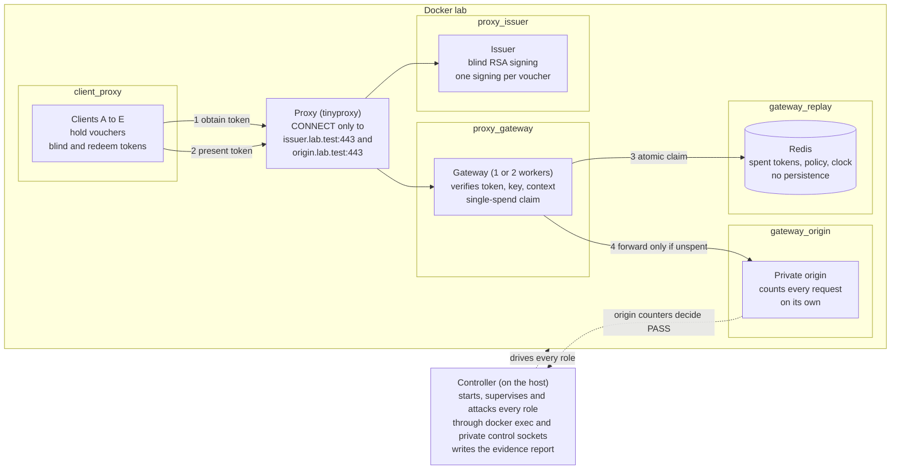
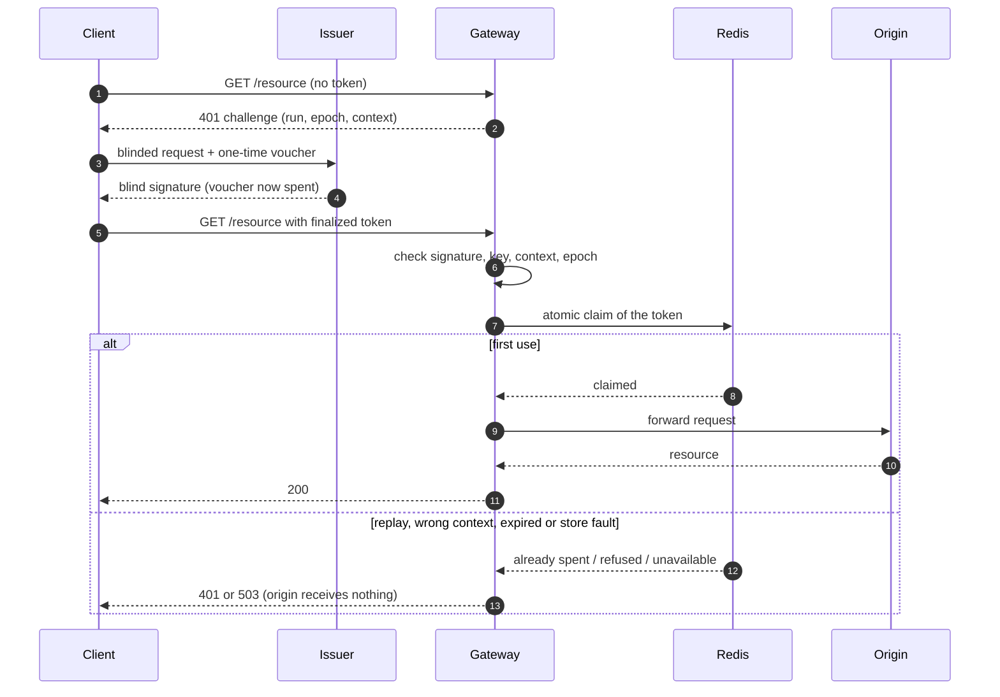

# AIORI-3-HACKATHON-PROJECTS
This repository will contain the code and resources for the AIORI-3 hackathon that will be developed during the AIORI-3

Video Link: https://youtu.be/4pnofXzmptA

## TokenForge — PS-024

Team **A3-PS024-TC119**, Pandit Deendayal Energy University. Krish Sonpal: gateway/replay/security/integration; Mihir Goswami: issuer/client/controller/lab/deployment. Faculty guide: Dr. Kaushal Shah.

The organizer-owned repository and submitted assets above are preserved. All implementation source lives under `src/` as requested by the existing `src/README.md`.

**Current stage: the full laboratory is implemented and runs locally; a fresh-machine rehearsal is still pending.** One controller recreates eight hardened containers (proxy, issuer, gateway with one or two workers, Redis, private origin, five clients on five internal networks), bootstraps the replay store through the shared artifact ([Redis bootstrap](docs/implementation/REDIS_BOOTSTRAP.md)), enables one run, supervises it and closes it through the reset barrier. The demo suite and the full seventeen-scenario security suite pass on a Windows 11 Docker Desktop host (the demo suite also runs on GitHub's Linux runner in CI), each scenario judged from the private origin's own counters and not from client claims. B0 and B1 gateway measurements exist but at the declared load the two are not distinguishable. Limits are stated, not hidden: Redis and origin links are plaintext on internal networks; only the recorded-highwater clock rollback is detected; a stolen unused token wins once (bearer-token limit); the proxy's 64-tunnel ceiling stops clients reaching the gateway's per-worker socket cap. See the [lab controller](docs/lab/CONTROLLER.md), [scenarios and reports](docs/lab/SCENARIOS_AND_REPORTS.md), [infrastructure](docs/lab/INFRA.md), the [demonstration guide](docs/demo/DEMO.md), the [runtime/controller guide](docs/implementation/GATEWAY_RUNTIME.md), [gateway status](src/services/gateway/README.md) and historical [G0 status](docs/implementation/G0_STATUS.md).

Read the [technical design](docs/implementation/TECHNICAL_DESIGN.md), [shared contract reference](src/contracts/README.md), and [dependency review](docs/security/DEPENDENCY_REVIEW.md). Executable contract schemas and fixtures define the interfaces shared by the gateway and lab components.

### Architecture


*System design sketch of the deployed lab. The two diagrams below show the same system as network topology and as one request's path.*

Eight containers on five internal Docker networks. Nothing is published to the host. Clients reach the issuer and the gateway only through one allow-listed CONNECT proxy, and only the gateway can reach Redis and the private origin. A controller on the host drives every role through `docker exec` and private control sockets.



How one request is judged:



The controller never trusts a client: a scenario passes only if the private origin's own counters (received, served, generation mismatches) and the gateway workers' verification counts agree with what the scenario expects.

### Local bootstrap checks

Use Node **24.22.1**. On Windows PowerShell use `npm.cmd` if script policy blocks `npm.ps1`; do not weaken execution policy. Other shells use `npm`.

```powershell
npm.cmd ci --prefix src/services/gateway --ignore-scripts
npm.cmd ci --prefix src/services/lab --ignore-scripts
npm.cmd run check:g0
npm.cmd audit --prefix src/services/gateway
npm.cmd audit --prefix src/services/lab
```

Optional independent fixture re-derivation with Python 3: `python scripts/derive-golden-fixture.py --check`.

Docker Desktop must be running Linux containers. From repository root:

```powershell
docker build -f src/services/gateway/Dockerfile -t tokenforge-g0:local .
docker run --rm --network none --read-only --cap-drop ALL --security-opt no-new-privileges --memory 128m --pids-limit 64 tokenforge-g0:local
docker build -f src/services/lab/Dockerfile -t tokenforge-lab-g0:local .
node src/services/lab/scripts/check-image.mjs tokenforge-lab-g0:local
```

The image prints public bootstrap metadata and exits; it does not open ports. Do not run `docker compose up` by hand: the controller owns the lifecycle (`node src/services/lab/src/controller/cli.ts`, see the [demonstration guide](docs/demo/DEMO.md)).

Contract `TF-PS024-1.0.0` is the accepted shared baseline. Both packages maintain independent dependency lockfiles and consume the shared definitions. Observable contract changes require coordinated consumer updates and a versioned change record.
