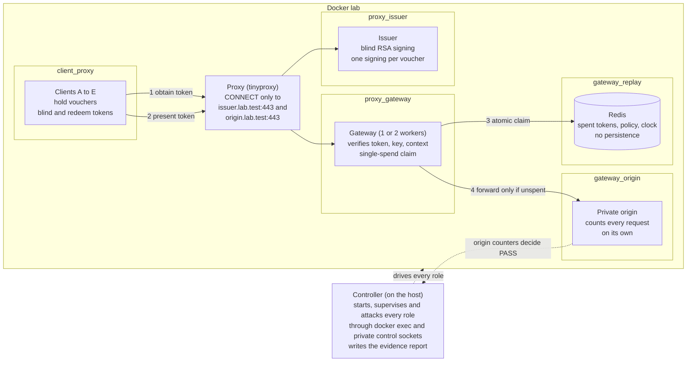
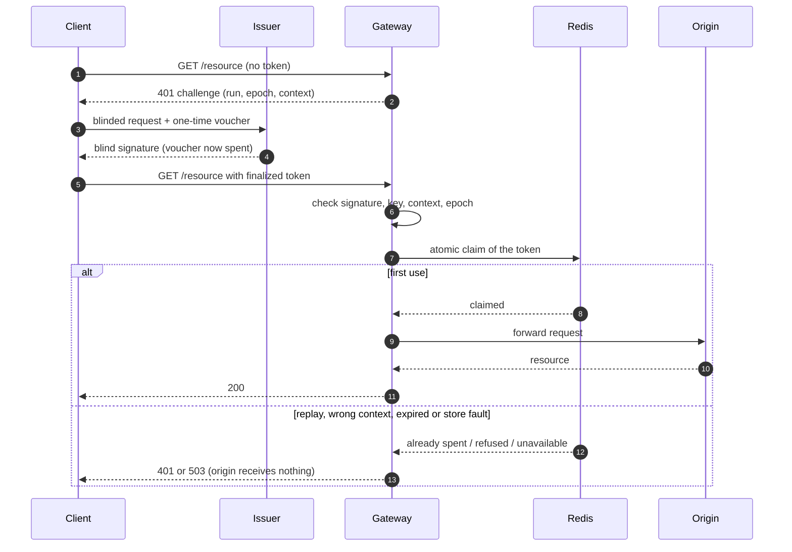

# AIORI-3-HACKATHON-PROJECTS
TokenForge protects a research resource through a Privacy Pass gateway, with one-time redemption, anonymous fixed-window quotas and a separate holder-bound token profile. This repository contains the implementation, test lab, and demonstration materials for problem statement PS-024.

- **Team introduction video:** https://youtu.be/4pnofXzmptA
- **System demonstration:** https://youtu.be/SlHhNhLCCNw

## TokenForge — PS-024

Team **A3-PS024-TC119**, Pandit Deendayal Energy University. Krish Sonpal: gateway/replay/security/integration; Mihir Goswami: issuer/client/controller/lab/deployment. Faculty guide: Dr. Kaushal Shah.

The organizer-owned repository and submitted assets above are preserved. All implementation source lives under `src/` as requested by the existing `src/README.md`.

**Standards-based baseline:** the original laboratory is implemented and runs locally; a fresh-machine rehearsal is still pending. One controller recreates ten hardened containers (proxy, issuer, gateway with one or two workers, Redis, private origin, five clients on five internal networks), bootstraps the replay store through the shared artifact ([Redis bootstrap](docs/implementation/REDIS_BOOTSTRAP.md)), enables one run, supervises it and closes it through the reset barrier. The demo suite and the full seventeen-scenario security suite pass on a Windows 11 Docker Desktop host (the demo suite also runs on GitHub's Linux runner in CI), each scenario judged from the private origin's own counters and not from client claims. Versioned aggregate measurements and a fixed alternating B0/B1 experiment are implemented; see the [benchmark methodology](docs/lab/BENCHMARK.md). Historical small-burst results did not distinguish the profiles. Limits are stated, not hidden: Redis and origin links are plaintext on internal networks; only the recorded-highwater clock rollback is detected; a stolen unused token wins once (bearer-token limit); the proxy's 64-tunnel ceiling stops clients reaching the gateway's per-worker socket cap. See the [lab controller](docs/lab/CONTROLLER.md), [scenarios and reports](docs/lab/SCENARIOS_AND_REPORTS.md), [infrastructure](docs/lab/INFRA.md), the [demonstration guide](docs/demo/DEMO.md), the [runtime/controller guide](docs/implementation/GATEWAY_RUNTIME.md), [gateway status](src/services/gateway/README.md) and historical [G0 status](docs/implementation/G0_STATUS.md).

### Regional prototype

The complete local three-profile comparison and separate holder scene passed on 15 November 2026. Each comparison profile delivered 25 resources with matching independent received/served counts and zero generation mismatches. Honest clients received 0 under shared-source IP limiting and 20 under ordinary Type2 and ARC. ARC malformed-proof, exhaustion, regenerated-slot, expiry/reset and Redis-loss checks also completed. See [the final aggregate evidence](docs/implementation/REGIONAL_FINAL_EVIDENCE.md) and [validation history](docs/implementation/REGIONAL_VALIDATION.md).

Use [the regional runbook](docs/lab/REGIONAL_RUNBOOK.md), [seven-minute narration](docs/demo/REGIONAL_NARRATION.md) and [new regional presentation](docs/submission/regional/TokenForge-Regional-2026.pptx). Original submitted materials and video links are preserved. Venue narration and physical-device rehearsal remain human tasks.

The regional application adds four server-selected profiles. Every run uses one fixed resource and a fresh server-defined 60-second window. The local portal controls five labelled lab clients; these are admitted entitlements, not verified human identities.

| Profile | Enforced allowance | What the demonstration shows |
| --- | --- | --- |
| IP comparison | 25 accepted uses for the shared TCP source | One abusive client can exhaust a shared address's allowance |
| Ordinary Type2 | Five independently single-use tokens per admitted entitlement | An abusive client's copied tokens cannot spend honest clients' wallets |
| ARC | Five verified presentation slots per anonymous credential | Fresh proof randomness or copied wallet state cannot create a sixth spend |
| Holder-bound Type2 | Five tokens, each with a fresh P-256 holder key | Stolen token bytes alone fail before consumption; the owner can still use them |

ARC is a separate research-library profile with private verification by the joint ARC operator. Holder binding is a separate experimental Type2 profile, not a change claimed to be part of standard Privacy Pass. It does not protect against private-key theft or interception of a complete valid signed request. All profiles require voucher admission and intact trusted state; none proves one-person-one-account.

With Node 24.22.1 and Docker Desktop running Linux containers, provision secrets once and start the local portal:

```powershell
node infra/scripts/provision-secrets.ts
node src/services/lab/src/controller/cli.ts regional --port 4174
```

If secrets already exist, keep them and skip provisioning; the generator deliberately refuses overwrites. Open `http://127.0.0.1:4174/`. The controller builds the pinned images before opening the page, so the first launch can take time. Start a profile, choose a client, acquire allowance, then access the resource. Comparison and holder-theft controls use separately reset experiments. Reset/expiry closes the generation; a new experiment is an explicit controller reset with fresh keys and entitlements, not a client quota refill. Ctrl+C requests shutdown.

The portal is the only loopback listener. Containers publish no service ports. Regional Compose adds an internal ARC bridge and a profile-gated ARC service; the original issuer remains logically separate from the verification gateway. The portal shows independent received/served counts and gateway claims, and labels incomplete observations rather than promoting them to PASS. Backend lifecycle and full venue rehearsal must be accepted before presenting the regional application as fully verified.

**Verification status:** deployed IP/Type2 comparison and holder theft/race checks passed. ARC resource access and selected quota/replay checks worked, but the complete ARC comparison was interrupted by a supervision refusal. Final regional acceptance is pending; the [validation checkpoint](docs/implementation/REGIONAL_VALIDATION.md) records the exact passing scopes and open checks.

See the [regional runbook](docs/lab/REGIONAL_RUNBOOK.md), [gateway/profile contract](docs/implementation/REGIONAL_GATEWAY.md), [quota/window definitions](docs/implementation/REGIONAL_CONTRACTS.md), and [security/evidence limits](docs/security/ASSUMPTIONS_AND_EVIDENCE.md). The historical baseline demo links and diagrams below retain their original scope.

Read the [technical design](docs/implementation/TECHNICAL_DESIGN.md), [shared contract reference](src/contracts/README.md), and [dependency review](docs/security/DEPENDENCY_REVIEW.md). Executable contract schemas and fixtures define the interfaces shared by the gateway and lab components.

### Architecture


*System design sketch of the deployed lab. The two diagrams below show the same system as network topology and as one request's path.*

The original baseline uses ten containers on five data-path networks. Regional Compose adds a sixth internal ARC bridge and optionally an eleventh container. Nothing is published to the host. Clients reach the issuer and the gateway only through one allow-listed CONNECT proxy, and only the gateway can reach Redis and the private origin. A controller on the host drives every role through `docker exec` and private control sockets.



How one request is judged:



The controller never trusts a client: a scenario passes only if the private origin's own counters (received, served, generation mismatches) and the gateway workers' verification counts agree with what the scenario expects.

### Local bootstrap checks

Use Node **24.22.1**. On Windows PowerShell use `npm.cmd` if script policy blocks `npm.ps1`; do not weaken execution policy. Other shells use `npm`.

```powershell
npm.cmd ci --prefix src/services/gateway --ignore-scripts
npm.cmd ci --prefix src/services/lab --ignore-scripts
npm.cmd run check:g0
npm.cmd audit --prefix src/services/gateway
npm.cmd audit --prefix src/services/lab
```

Optional independent fixture re-derivation with Python 3: `python scripts/derive-golden-fixture.py --check`.

Docker Desktop must be running Linux containers. From repository root:

```powershell
docker build -f src/services/gateway/Dockerfile -t tokenforge-g0:local .
docker run --rm --network none --read-only --cap-drop ALL --security-opt no-new-privileges --memory 128m --pids-limit 64 tokenforge-g0:local
docker build -f src/services/lab/Dockerfile -t tokenforge-lab-g0:local .
node src/services/lab/scripts/check-image.mjs tokenforge-lab-g0:local
```

The image prints public bootstrap metadata and exits; it does not open ports. Do not run `docker compose up` by hand: the controller owns the lifecycle (`node src/services/lab/src/controller/cli.ts`, see the [demonstration guide](docs/demo/DEMO.md)).

Contract `TF-PS024-1.0.0` is the accepted shared baseline. Both packages maintain independent dependency lockfiles and consume the shared definitions. Observable contract changes require coordinated consumer updates and a versioned change record.
