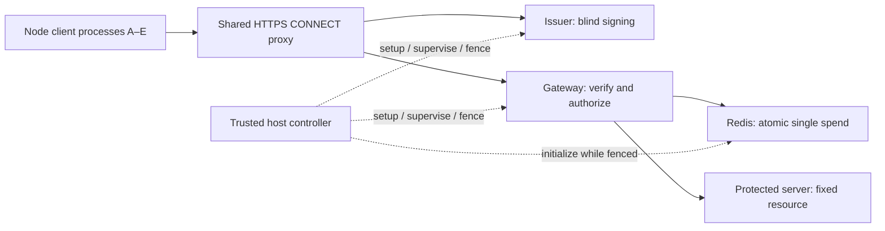

# TokenForge technical design

PS-024: Privacy Pass token issuance and anti-replay gateway. Accepted bootstrap contract: `TF-PS024-1.0.0`, 26 October 2026.

**Implementation status:** the gateway coordinator now connects bounded admission, signature/context verification, real Redis single-spend claims and fixed-origin transport. Component/integration tests use genuine blind-issued tokens, a restricted Redis ACL and an independently counted test origin. Shared encodings, leases and bootstrap builds are also tested. The programmatic HTTPS listener is also implemented and tested with real TLS. The serving process, actual issuer/client service deployment, supervisor/control transport, full reset barriers, network integration and performance measurements remain planned. See [bootstrap status](G0_STATUS.md) for historical G0 evidence and the [gateway component status](../../src/services/gateway/README.md) for subsequent work.

The selected protocol is RFC 9578 Type 2 with RSA-2048, SHA-384/PSS and 48-byte salt, using the pinned existing Privacy Pass library. See [dependency review](../security/DEPENDENCY_REVIEW.md) and [contract reference](../../src/contracts/README.md). No new cryptographic primitive is proposed.


For the demonstration, explain **client → verification gateway → protected server**. Privacy Pass also requires a logically separate **issuer** to sign credentials before redemption. Do not delete the issuer or merge its signing secret into the gateway to make the picture have exactly three boxes.



There are two protocol phases: **issuance** obtains the credential; **redemption** presents it to the gateway. Proxy, replay store, private server and controller support these phases. The controller/dashboard is not an extra authorization authority in the public request path.


We will reject forged/modified credentials, genuine wrong-context credentials and second use of an already-claimed credential under the stated trust/time/state assumptions, including a trustworthy non-regressing Redis/host wall clock and no silent replay-state rollback (§6.1). A copied **unused** bearer token can still be spent by its thief first. Single use ensures one winning claim; it does not identify the rightful presenter or prevent voluntary sharing.

Mitigate exposure through validated TLS, memory-only token inventory, no credential logs, restricted networks and bounded context lifetime. Demonstrate the theft limit explicitly. Do not claim “an attacker cannot break anything,” absolute anonymity, exactly-once delivery, anti-Sybil identity, or theft-proof tokens. Adding device/channel binding would require a separate compatible design and privacy analysis; it is not hidden inside this baseline.


## 1. Contract A — Public protocol and shared policy

The schemas, fixtures and helpers in `src/contracts/` define the accepted executable interface baseline. These sections specify the target services; the bootstrap does not yet implement the HTTP, replay-store or lifecycle components.

### 1.1 Service identities and public endpoints

| Endpoint | Behavior |
|---|---|
| `https://issuer.lab.test/.well-known/private-token-issuer-directory` | RFC directory; public key/configuration only |
| `https://issuer.lab.test/issue` | POST exactly one Type 2 binary request with one-use lab voucher |
| `https://origin.lab.test/resource` | GET only, exact configured authority/path, no query/body; challenge or token redemption |
| `http://protected-origin:8080/resource` | Private fixed GET; ≤16 KiB deterministic body; independent received/generation-mismatch/served aggregate counters |

Issuer/gateway negotiate TLS 1.3 and HTTP/1.1 through CONNECT. Clients validate the lab CA and expected hostname. `rejectUnauthorized=false`, wildcard arbitrary issuer fetching, redirect-based endpoint selection and untrusted authority forwarding are forbidden. No token in URL/query/cookie. No public admin, voucher-provisioning, origin-counter or reset endpoint.

The directory carries `issuer-request-uri` and `token-keys[{token-type:2, token-key:<padded base64url RSA-PSS SPKI>}]`. Full key ID is SHA-256 of the correct encoded public key. Use the library's RSA-PSS SPKI conversion; hashing a generic `rsaEncryption` SPKI instead produces a different identifier. Public directory key encoding includes RFC-required padding, even though our separate local voucher encoding does not.

### 1.2 Exact wire data

```text
TokenRequest = U16(0x0002) || U8(truncated_token_key_id) || blinded_msg[256]
  total 259 bytes; truncated ID is the last byte of the full key ID
TokenResponse = blind_sig[256]
  total 256 bytes
AuthenticatorInput = U16(0x0002) || nonce[32] || challenge_digest[32] || token_key_id[32]
  total 98 bytes
Token = AuthenticatorInput || authenticator[256]
  total 354 bytes
```

Issuer request/response content types are `application/private-token-request` and `application/private-token-response`. Use existing library serialization/finalization and independent conformance fixtures. Wrappers enforce exact lengths/trailing-byte rejection before permissive library parsers. Each outstanding issuance has a fresh library Client instance and private pending state; nonce alone is not the complete input to blind.

The issuance-only lab admission header is `X-Lab-Voucher: <base64url of 32 random bytes, no padding>`, exactly one field/value of 43 ASCII characters with canonical pad bits. This is our enrollment wrapper, not an RFC Privacy Pass field. Generate vouchers using the OS CSPRNG. The issuer retains only `SHA256(ASCII("PS024-voucher-v1") || voucher_bytes)` in its preprovisioned set; remove a valid digest atomically before starting signing. Signing failure/uncertainty consumes that attempt; never reinsert it. Unknown/reused/invalid vouchers return a fixed generic **403** `issuance-not-authorized`. Malformed HTTP framing returns 400; unsupported token type, mismatching truncated key ID or wrong blinded-message size in a bounded, complete request returns **422** `issuance-request-invalid` per RFC 9578 §3.2. Reject the latter before consuming a voucher. A successfully parsed request whose BlindSign operation fails does not refund the consumed voucher; use a fixed safe failure result, never an exception dump. Internal unavailability returns 503. Wrong media type is 415. Distinguish the **4096-byte transport body cap** from the **259-byte valid protocol size**: a complete 258/260-byte body within the cap gets 422, whereas a declared/received body above 4096 may be rejected as 413 without buffering it. Excessive headers may get 431 or transport closure. Require unambiguous Content-Length for this controlled HTTP/1.1 issuance client; reject Transfer-Encoding/ambiguous framing with 400. Gate 0 freezes these response bodies/ordering and boundary tests. Prohibit duplicate voucher headers and remove this header from any forwarded protected request. [RFC 9578 §3.2](https://www.rfc-editor.org/rfc/rfc9578.html#section-6.2)

Redemption uses one unambiguous `Authorization: PrivateToken token="<base64url>"`. A missing token yields 401 with `WWW-Authenticate: PrivateToken challenge="...", token-key="..."`. Follow the RFC's base64url padding and unknown-auth-parameter rules; reject duplicate known fields/ambiguous credentials. Gateway responses/resource policy use `Cache-Control: no-store`; no reusable clearance cookie or cache bypasses a new token decision.

### 1.3 Canonical context and spend identity

```text
epoch = floor((redis_now_ms - run_start_ms) / 600000)
epoch_start_ms = run_start_ms + epoch * 600000
epoch_end_ms = epoch_start_ms + 600000
  negative offsets are invalid, not a usable negative epoch

redemption_context = SHA256(
  ASCII("PS024-context-v1") || U16(0x0002) || run_id[16] || token_key_id[32]
  || U64(epoch) || U64(epoch_start_ms) || U64(epoch_end_ms)
  || LP("issuer.lab.test") || LP("origin.lab.test") || LP("GET /resource")
)
LP(s) = U16(byte_length(s)) || ASCII(s)
TokenChallenge fields:
  token_type = 0x0002
  issuer_name = issuer.lab.test
  redemption_context = above 32 bytes
  origin_info = origin.lab.test
challenge_digest = SHA256(library_RFC_serialize(TokenChallenge))
spend_id = SHA256(ASCII("PS024-spend-v1") || serialized AuthenticatorInput)
spent_key = "pp:spent:" || lower_hex(spend_id)
```

Integers are unsigned big-endian; manifests use safe nonnegative integer millisecond values, never floating-point seconds. Golden fixtures must distinguish hashing serialized RFC challenge bytes from JSON. All clients share the same run/key/epoch/scope context; do not add account/client/voucher identifiers. Future contexts can be predictable: validity does not prove issuance during that epoch.

### 1.4 Public run manifest and configuration digest

Freeze these required public fields in `src/contracts/schemas/run-manifest-v1.json`:

```json
{
  "schema_version": 1,
  "contract_version": "TF-PS024-1.0.0",
  "run_id": "<32 lowercase hex characters>",
  "policy_version": 1,
  "run_start_ms": 0,
  "epoch_ms": 600000,
  "guard_ms": 30000,
  "token_type": 2,
  "token_key_id": "<64 lowercase hex characters>",
  "token_key_spki_b64url": "<public RSA-PSS SPKI>",
  "issuer_name": "issuer.lab.test",
  "origin_name": "origin.lab.test",
  "resource_scope": "GET /resource",
  "issuer_request_uri": "https://issuer.lab.test/issue",
  "snapshot_script_sha1": "<40 lowercase hex characters>",
  "claim_script_sha1": "<40 lowercase hex characters>",
  "gateway_profile": "B1",
  "limits": "<strict object of section 4 settings; not a free-form string>"
}
```

This is a shape illustration, not a runnable manifest; `limits` must be a typed object in Gate 0, and zero here is not permission to start with an invalid timestamp. Include fixed internal origin/store endpoint names, expected role-network listeners and any non-secret operational values needed to prevent configuration drift in the strict schema. Never embed passwords, vouchers, private keys or tokens.

`config_digest = SHA256(UTF8(canonical_json(public_manifest)))`, lowercase hex. Contract helper canonicalizes schema-valid JSON with recursively sorted ASCII object keys, ordered arrays, ASCII strings and safe integers/booleans/null; reject unknown fields and unsupported values. This is a restricted application encoding, not a claim to implement every aspect of RFC 8785. Do not include `config_digest` in its own hash. Both owners must reproduce the same fixture.

The manifest digest is a control/configuration consistency check; it does not replace the canonical context, signature, trusted provisioning or secret credentials. Store policy fields plus expected digest in `pp:policy`; runtime workers must verify the active manifest/policy correspondence.

### 1.5 Golden fixtures and version checks

Public/test-only fixtures contain: source provenance, RSA-PSS SPKI bytes, full/truncated key ID, fixed run/epoch/scope values, canonical context input/output, serialized challenge/digest, fixed nonce/authenticated input/spend ID, and exact expected lengths. Add independent RFC vectors for crypto compatibility; a client verifying its own output through the same mistaken wrapper is insufficient.

Each consumer reproduces the shared-policy results independently once before relying on shared helpers, then both consumers run the golden suite. Fixed randomness is permitted only in isolated unit/vector tests, never a deployed configuration flag. Test keys are clearly labeled and are never the fresh live issuer key. Record contract version and source commit in every built image/report; PREPARE must reject mismatches.

## 2. Contract B — Management, readiness, supervision and reset

**This is the highest-risk integration boundary.** Mihir owns the controller; Krish owns the gateway's lifecycle enforcement. Both implement the following schema and state machine. Public protocol success must not depend on an undocumented private function in the other owner's code.

### 2.1 Local transport and message envelope

Each role has an application-private `/run/ps024/control.sock`, directory mode 0700/socket 0600, owned by its application UID. No shared socket mount, public TCP admin endpoint or container Docker socket. A controller-invoked helper connects inside the target container. Secrets travel via private stdin/control messages, never command-line arguments, console dumps or persistent control transcripts.

Newline-delimited UTF-8 JSON; maximum message 65536 bytes; strict schema; request/reply IDs must match. A persistent helper connection may carry commands/heartbeats. Helpers return structured messages, never echo submitted payloads. Fixed errors do not stringify a request or Redis command.

Commands are dispatched asynchronously with responses correlated by request ID; do not assume response order. Allow at most one running scenario per client, at most eight ordinary pending control requests per connection, and a reserved stop path for FENCE. A long `RUN_SCENARIO` response may remain pending, but STATUS/REPORT/FENCE must remain responsive on the role's control listener. FENCE cancels the scenario and then satisfies the strong barrier; it must not wait in a FIFO behind scenario completion. The controller uses independent role I/O and nonblocking child processes, so awaiting a scenario never blocks issuer/gateway heartbeats or Docker monitoring. Test this with a deliberately stalled scenario and an in-flight FENCE.

```json
{
  "version": 1,
  "request_id": "<fresh 32-hex ID>",
  "command": "PREPARE_RUN",
  "run_id": "<32-hex ID or null only where allowed>",
  "config_digest": "<64-hex digest or null only where allowed>",
  "target_incarnation": "<discovered process-incarnation ID>",
  "payload": {}
}
```

Reply fields: `{version, request_id, ok, result, state, run_id, config_digest, incarnation, data}`. `incarnation` is fresh at process start, not the reusable container/service name. Fixed error results: `BAD_VERSION`, `BAD_MESSAGE`, `WRONG_RUN`, `WRONG_CONFIG`, `WRONG_INCARNATION`, `ILLEGAL_STATE`, `DEPENDENCY_UNAVAILABLE`, `FAULTED`; details must be allowlisted/non-secret.

`STATUS` discovers state/incarnation and can use null run/config/target on initial discovery. `FENCE` is an idempotent privileged stop command and may deliberately fence the current service even if the caller's remembered run is stale; its response identifies what was fenced. All other mutations require the discovered target incarnation. `CREATE_ISSUER_KEY` and the issuer's initial `PREPARE_RUN` use `config_digest=null` in the envelope because no old prepared digest exists; PREPARE carries the new manifest and its proposed digest in the payload, validates them, and returns the accepted digest. Initial PREPARE for other fresh roles follows the same null-current-digest rule. Later commands require the accepted digest. No silent key generation, reset or voucher replenishment on a retry.

### 2.2 State machine and commands

```text
FENCED -> PREPARED -> READY -> ENABLED -> CLOSING -> FENCED
                         any unsafe event -> FAULTED
FAULTED cannot re-enable the same run
```

`READY` means dependencies/configuration have been validated, not that public admission has started. Configuration/credential provisioning is allowed only before enable while fenced/preparing. `FENCE` does not delete security state. Only controller teardown after the barrier may discard it. Preserve a terminal `run_closed` latch and run ID even after state becomes FENCED; FENCED alone must never permit preparing/enabling the same closed run again. A new run requires the controller's full reset with fresh key/incarnations, except the explicitly quarantined security-client fixture described in §6.3.

| Command / target | Required behavior and output |
|---|---|
| `CREATE_ISSUER_KEY` → issuer | New run ID while FENCED; generate dedicated key internally; return correctly encoded public SPKI/full key ID only. Exact duplicate request may return the same in-memory result; never generate another key silently |
| `PREPARE_RUN` → issuer/gateway/origin/clients | Validate immutable public manifest and role-specific endpoints/secret references; retain only what that role needs. Issuer confirms manifest matches its generated key |
| `PROVISION_VOUCHERS` → issuer | Digest-only batches, maximum 128 per message, before enable; reject duplicate/re-added digests/provisioning after enable. Entire scenario inventory prepared in advance |
| `PROVISION_CLIENT` → each client | Its own plaintext vouchers/public configuration via local private transfer; maximum 128 vouchers/message; no other client's inventory or secret-bearing acknowledgement; same bounded completion protocol below |
| `CHECK_READY` → issuer/gateway/origin/clients | Validate prepared state. Gateway requires exactly the profile's configured workers, with every worker's key import, expected Redis policy/guards/config digest/script availability and pools ready; report READY only after all checks |
| `ENABLE` → issuer/origin/clients/gateway | Exact prepared run/config/incarnation; gateway enabled last. Repeat ENABLE for the same active immutable state may acknowledge, not mutate |
| `HEARTBEAT` → issuer and gateway | Matches active run/config/incarnation; renew controller-supervision lease only while active; never clear a fault latch |
| `FENCE` → all serving components | Stop new work, cancel queues, abort active transports, suppress late callbacks, close role connections; return strong FENCED acknowledgement only when barrier conditions are met |
| `STATUS` → any role | State/run/config/incarnation/readiness/fixed fault reason only; no credential material |
| `REPORT` → any role | Section 6's allowlisted counters/histograms and origin aggregate count; no raw request/event history |
| `RUN_SCENARIO` → client harness | Named frozen scenario, cohort/profile/seed for scheduling only; protocol randomness remains genuine; returns sanitized assertions/results, not token inventory |

No `EXPORT_TOKEN`, `EXPORT_SIGNING_KEY`, arbitrary `EVAL`, arbitrary upstream URL or public reset operation. Cross-client theft/replay fixtures execute inside the trusted harness with disposable in-memory credentials, not through a new public administrative feature.

Both provisioning commands carry `{batch_id, batch_index, expected_total, final_batch, items}` in their role-specific strict payload, with at most 128 items and the overall 65536-byte limit. Before enable, the receiver tracks monotonically increasing batch indices, total received and duplicate items/digests in memory; reject duplicate/replayed batches instead of restoring inventory. `final_batch=true` seals provisioning only when the expected total is reached; CHECK_READY requires that seal. The issuer's total equals the sum of client inventories. Ambiguous provisioning aborts the run rather than retrying/refilling. Freeze a per-profile maximum total inventory and verify its memory budget at G0; do not accept an unbounded caller-provided total. Public reports carry counts only, never batch contents.

### 2.3 Controller-loss detection refinement

The controller sends authenticated local heartbeats every 1 second to issuer/gateway through persistent helpers; each locally measures freshness using a monotonic timer, with an initial 3-second maximum lease. Missing lease closes public admission and latches the run faulted. Tuning requires a recorded change and both consumers/tests.

**Worker enforcement is mandatory.** Each gateway worker checks its own unexpired monotonic lease before admission, at promotion and immediately before forwarding. A supervisor-only timeout is insufficient: a paused supervisor must not leave workers serving. Check expiration synchronously **before renewing** any lease, rather than relying on the timeout callback running first. A late heartbeat cannot revive an expired run. Forwarded heartbeats carry the original gateway-local monotonic expiry, not a new three-second duration measured when the worker finally receives IPC. Use a confirmed common OS monotonic clock across the supervisor/workers in the same container; freeze/test its representation at G0. Issuer uses the same expiration-before-renewal rule locally. No cross-host clock comparison is assumed.

Each controller/helper link allows only one heartbeat outstanding, with increasing sequence numbers bound to the run/incarnation; stale/duplicate replies cannot renew anything. Do not accumulate heartbeats in an offline/retry queue. Test supervisor pause, delayed IPC, a heartbeat processed after expiry but before a delayed timer callback, and controller/helper loss. Lease expiry latches closure until a fresh fenced run.

Initial ENABLE is the sole operation allowed to install an initial three-second lease for that newly prepared run. It installs the deadline in all configured workers before opening admission, returns their acknowledgements, and then periodic heartbeats renew it. Repeat ENABLE never refreshes a deadline or reopens a closed run. Keep servicing issuer heartbeats while waiting for gateway readiness/enable; a slow next-role operation is not permission to omit supervision. If enable/ack takes too long, fence/reset rather than renew an already expired lease.

Worker-local representation: `WorkerLease` uses `process.hrtime.bigint()` OS-monotonic nanoseconds. Gateway-internal grants have exactly `{version:1, run_id, config_digest, supervisor_incarnation, worker_incarnation, sequence, issued_at_ns, expires_at_ns}`. Nanoseconds are canonical unsigned decimal strings, at most 20 digits and no greater than uint64 maximum; no floating-point or wall-clock conversion. The initial grant has sequence 0; later grants have strictly larger safe-integer sequence, issuance time and expiry. Expiry is exactly issuance plus 3000000000 ns, with issuance no later than worker receipt and expiry later than receipt. Delayed IPC preserves this original deadline. Reject invalid grants without extending the lease; expiration of the existing lease wins before processing any renewal, including when validation itself spans the boundary.

These grants are private supervisor-to-worker data, not additions to the frozen controller API: controller HEARTBEAT still carries only `{seq}` in its payload. The future gateway supervisor must validate that command, timestamp its own receipt once, preserve the resulting deadline in worker IPC, maintain one outstanding heartbeat, and complete the all-worker ENABLE barrier before serving. The worker core supplies terminal local cancellation and clock/identity/sequence checks; it neither authenticates an IPC channel nor drains transports. It offers no reset or `markFenced` operation. Explicit stop remains CLOSING until the future lifecycle host proves quiescence; faults remain FAULTED. Status alone is not authorization: call `checkActive()` immediately before each protected action, with no intervening await. Bind actual replay/crypto readiness before `markReady()` and connect the closure hook/cancellation signal to the enclosing worker.

The production-image check brackets timestamps from two real child processes between parent `hrtime.bigint()` reads on the pinned Linux runtime. This verifies the tested same-container clock compatibility, not cross-host comparability or a completed supervisor/worker deployment. Keep all gateway workers in that same OS clock domain; do not use per-process `performance.now()` or `uptime()` values as shared IPC expiries. [Node 24 high-resolution time](https://nodejs.org/docs/latest-v24.x/api/process.html#processhrtimebigint)

Docker event monitoring continuously detects relevant process/container exits or incarnation changes. `restart: "no"`; no same-run worker respawn or connection-driven auto-recovery. Controller event-stream/helper loss is unsafe, not a reason to keep serving indefinitely. A replacement controller first fences/kills old processes and confirms exit; it cannot renew an expired run into service.

This gives bounded detection under healthy scheduling, not instantaneous revocation or a production consensus protocol. Already-authorized work may have begun; teardown/reset must still wait for the barrier. Deliberately test controller/helper loss and delayed event delivery. Controller monitoring overhead must be recorded in benchmarks.

### 2.4 Startup order

1. Start Docker role containers in FENCED mode and Redis with no active run; no host-visible protected service.
2. Controller discovers incarnations and confirms no old workers/connections are serving.
3. Allocate fresh run ID; issuer creates a fresh signing key and returns public material.
4. Controller reads Redis `TIME` for `run_start_ms`; uses Krish's schema/bootstrap requirements to install immutable `pp:policy`, existing `pp:clock`, load the exact scripts and set minimal ACLs while fenced. Compute public manifest/config digest consistently after public key/script SHAs/settings are known; store the matching digest with policy.
5. PREPARE all roles. Provision whole demo/benchmark voucher cohort and distribute each client's own inventory. Keep plaintext voucher mapping only as long as test setup needs it.
6. CHECK_READY all roles; verify contract/config/incarnations. Issuer key must still be the one used by the manifest.
7. Enable issuer/origin/clients, establish supervision heartbeats, then enable gateway last. An issuer READY endpoint alone is not overall readiness.
8. Controller remains running while scenario/benchmark/demo executes. On any unsafe dependency or supervision event, initiate closure.

### 2.5 Strong reset barrier

For intentional stop or fault, stop admitting first and broadcast FENCE. Gateway supervisor closes admission, removes queued jobs, prevents any late verify/Redis callback from authorizing another forward, aborts upstream/downstream work, closes pools/sockets and waits for active work to settle. A worker that cannot acknowledge is terminated.

Controller waits for **strong FENCED acknowledgements** from all old serving workers, or kills the relevant container/process tree and confirms exit. Use a bounded local control wait (initial 10 seconds); timeout means kill-and-confirm, not assume success. A hung process/native promise may require process termination. Failure to confirm old processes are gone means remain closed.

Only after that barrier: stop/discard old Redis process/state; remove old accepted public key/cache; end old issuer process/key; clear client inventory; generate fresh run/key and initialize fresh guards/scripts/vouchers. Never flush Redis while old gateway workers can still claim. No late callback from an old generation may touch a new generation's store/origin.

The origin participates in the barrier too: stop accepting, close listener/existing sockets, settle/abort handlers, then recreate its process/counters for the next run. Abort at the gateway does not undo bytes already delivered to the origin. Require its strong acknowledgement or kill-and-confirm exit. Old-run reports snapshot settled counts before destruction; never reuse an old count as a new run's baseline. If a forced kill prevents obtaining the settled counter, report it as **unavailable/INCONCLUSIVE**, not zero. Gateway injects an internal `X-TokenForge-Run` header containing its prepared run ID; origin requires the matching enabled run and refuses a mismatch before serving the protected resource. Strip all client-supplied `X-TokenForge-*` headers first. This is generation attribution within a trusted private network, not a replacement for token authorization or a secret authentication scheme.

Maintain three independent origin counters: `protected_requests_received`, `generation_mismatches`, and `resources_served`. Increment **received before generation validation** for every fully parsed request targeting the protected route, including wrong/missing generation headers; count mismatches separately, and increment served only when the resource is actually served. Throughout this design, “origin arrival” means **received**, not served. No-forwarding assertions require unchanged received count; served=0 alone cannot prove the gateway did not forward. Component tests deliberately submit a wrong-generation request and require received +1, mismatches +1, served +0. Reports bind counters to the origin process incarnation/run and retain aggregate deltas only.

**Ambiguous control mutation:** if key creation/provisioning/enable cannot be confirmed, close and redo fresh setup; do not invent exactly-once administrative behavior. STATUS can clarify fixed state, but live voucher replenishment and automatic mutating retries are forbidden. Controllers must not race each other; one trusted controller owns one Compose project/run, protected by a local exclusive process lock.

## 3. Contract C — Replay Store and gateway decision

### 3.1 Redis schema and script calls

One dedicated store, one active run, one primary; no AOF/RDB/replicas/backups/failover. `maxmemory=268435456`, `noeviction`, initial container limit 384 MiB, 70% warning. Keep policy/clock non-expiring for the run. Live guard loss is fatal, never repaired by workers.

**Security precondition:** Redis/host wall time is trustworthy and non-regressing, and accepted replay state is not silently rolled back/restored. Redis absolute expiration plus a 30-second guard is not protection against arbitrary wall-clock rollback. Example outside the guarantee: a spent key expires during a forward time excursion, time then returns to the old epoch before another claim observes the excursion, and the old highwater cannot prove deletion occurred. Even polling cannot rule out every between-observation excursion. Monotonic controller leases do not repair that wall-clock problem.

Detected backward time against recorded highwater, observed unsafe time jumps, VM/store restoration or uncertain continuity requires closure and a trustworthy-clock full reset, not an automatic same-key recovery. Do not run host-clock manipulation or VM snapshot restoration during normal service. S17 tests **detected regressions against recorded state**, not arbitrary rollback resistance. If that stronger requirement is later introduced, stop and review a changed design, such as non-expiring run-wide spent records with a fixed voucher cap and monotonic hard run lifetime/fresh-key reset; update retention and tests. Do not silently claim the current TTL design already supplies it.

| Key | Value |
|---|---|
| `pp:policy` | HASH, exact fields below; immutable public policy/run/key/config values from the manifest |
| `pp:clock` | HASH, exact fields below; existing run guard, last observed authoritative claim time, highest epoch, closed state |
| `pp:spent:<64-lower-hex>` | String `1`, absolute expiry `epoch_end_ms + 30000` |

`pp:policy` HASH fields are exactly `schema_version`, `run_id`, `token_type`, `token_key_id`, `config_digest`, `run_start_ms`, `epoch_ms`, `guard_ms`. `schema_version=1`, `token_type=2`, `epoch_ms=600000`, `guard_ms=30000`. `pp:clock` HASH fields are exactly `run_id`, `last_now_ms`, `highest_epoch`, `closed`, initialized to the new run ID, `run_start_ms`, `0`, `0`. IDs/digests use the manifest's lowercase hex lengths. All numeric HASH values are canonical unsigned decimal ASCII strings (no sign, whitespace, exponent or unnecessary leading zeros); `closed` is exactly `0` or `1`. Reject wrong Redis types, unexpected/missing fields, invalid encodings and unsafe arithmetic; derived timestamps must be safe integers ≤9007199254740991 and epoch/time must be consistent with recorded highwater. Both HASH keys have no TTL. Spent keys must have the expected string value and deadline; an unexpected existing representation is unsafe, not an ordinary replay.

Bootstrap/readiness reads and compares **all policy fields** with the trusted manifest, validates their computed digest association and checks the initial guard. A stored digest beside corrupted fields is not proof that those fields match. Scripts validate the critical numeric constants/run/key/digest and all time/guard relationships they use; immutable policy may not be edited during a run. G0 supplies exact bootstrap/validation fixtures and a field/type corruption test matrix.

Snapshot script:

```text
EVALSHA <snapshot_sha1> 2 pp:policy pp:clock
  <expected_run_hex> <expected_key_hex> <expected_config_digest_hex>
-> ["SNAPSHOT", run_hex, key_hex, config_digest_hex, now_ms, epoch, epoch_start_ms, epoch_end_ms]
```

Read-only in behavior; ordinary EVALSHA, not an assumed `EVALSHA_RO` setup. Read stored policy/guard and Redis TIME; reject unsafe/missing/closed/mismatched state; allocate no token state, do not update highwater. Error result `RUN_UNAVAILABLE` or `CLOCK_UNSAFE`.

Atomic claim script:

```text
EVALSHA <claim_sha1> 3 pp:policy pp:clock pp:spent:<digest_hex>
  <expected_run_hex> <expected_key_hex> <expected_config_digest_hex> <candidate_epoch> <digest_hex>
```

Validate required field types/presence, active run/full key/**expected configuration digest**, closed/clock guard, stored/current time bookkeeping, lower-hex spend digest and exact key-prefix correspondence. Snapshot also checks the expected digest and the adapter validates its echoed identity/digest. Any mismatch returns `["RUN_UNAVAILABLE"]` and closes the run. Candidate epoch is checked against current Redis-derived epoch; caller timestamps/expiry are not authoritative. Derive bounds from policy and execute inside the same script:

```text
SET pp:spent:<digest_hex> 1 NX PXAT <epoch_end_ms + 30000>
```

All script returns are tagged arrays: `["CLAIMED", absolute_expiry_ms]` on success; `["ALREADY_SPENT"]`, `["EPOCH_CLOSED"]`, `["RUN_UNAVAILABLE"]` or `["CLOCK_UNSAFE"]` otherwise. Snapshot errors use the same one-element tagged-array convention. Numeric timestamp/epoch fields are integer RESP values; IDs/tags are strings; no null/boolean/error reply is a valid result. Typed adapter rejects unexpected length/type/tag and must not interpret any truthy array as success. Successful NX insertion is the single-spend linearization point; no separate GET+SET or non-atomic front-time check. Script SHA-1 is Redis's script identifier, distinct from token/context SHA-256. [Redis EVALSHA](https://redis.io/docs/latest/commands/evalsha/), [SET](https://redis.io/docs/latest/commands/set/)

The internal script must validate everything that can fail before mutating state. Redis Lua gives atomic execution, **not transaction rollback after a runtime error**. A script error/failed allocation after partial guard updates is unsafe; close the run. The script must never manufacture missing guards. Cross-run namespace separation relies on the dedicated fenced store and signed context, not a caller-selected run namespace.

Redis bootstrap consumes the reviewed replay scripts/schema unchanged. Runtime ACL requirements include the minimal commands/keys including the script-internal commands and necessary pinned-client handshake. Controller alone loads scripts/administers ACLs/initializes policy. Gateway cannot CONFIG/FLUSH/SCRIPT LOAD/ACL-administer; allowed write privileges are still sensitive and do not protect against a compromised gateway.

### 3.2 Gateway sequence and HTTP outcomes

Before crypto, check run/lease latch, trusted authority/route/method, bounded transport/framing and queue admission. Missing token obtains a current shared challenge through snapshot. With a token: strict parse/type/full-key ID → public RSA-PSS verification → authoritative snapshot and configured current challenge digest → canonical spend ID → atomic claim → recheck worker lease/open latch → one sanitized fixed-origin attempt. The claim repeats authoritative time/context checks atomically; a preceding snapshot cannot authorize a token across a boundary by itself.

`RequestCoordinator` implements this worker-local sequence from an owned, bounded raw-header view. It accepts exactly one Host matching the configured name (case-insensitive, optional `:443`), origin-form `/resource`, GET, no body, no Transfer-Encoding/Expect/Upgrade and at most one canonical Content-Length of `0`. Generic invalid headers or ambiguous Host fail with400; otherwise precedence is authority421, route404, method405, then body/framing400. Compute preflight before waiting, but send its rejection through the same admission bounds. The implemented HTTPS adapter enforces TLS/HTTP framing, body absence, socket limits and request deadlines; a supplied metadata flag alone does not establish transport validity. See the gateway component reference for the exact one-request-per-connection policy.

The verifier's split signature stage produces a private, single-use receipt stored in a per-verifier WeakMap, with owned token bytes. Another verifier, forged object or reused receipt cannot yield a claim candidate. Consume it against an authoritative snapshot before claim. Replay and origin expose immutable public run/config binding views, checked during preparation; replay's terminal signal closes the worker immediately, including idle dependency loss during delayed origin connection. Recheck live permits after every asynchronous stage and immediately before claim, forwarding and protected response delivery. A confirmed claim followed by cancellation remains spent and cannot trigger a retry/refund.

Delivery is a trusted async sink. Keep the flow permit until its write/abort cleanup promise settles, including after the origin response has been buffered. A partial or failed sink is never followed by a replacement response. Every final401 obtains its own fresh snapshot; missing/unsafe state yields503 without WWW-Authenticate. Shutdown publishes one cached drain promise before invoking callbacks, so reentrant closure cannot repeat dependency cleanup. It waits for origin jobs/sockets and admitted flows, including stalled sinks, but is not the listener/process strong barrier. The HTTPS adapter maps upstream502/504 to empty no-store responses with Content-Length: 0, without adding public error-body labels.

| Condition | HTTP/result |
|---|---|
| Missing token, valid run | 401 `token-required` + current shared challenge/public key |
| Malformed/duplicate/trailing/incorrect-length credential | 400 `token-malformed` |
| Unsupported type | 401 `token-type-unsupported` |
| Unknown full key ID | 401 `token-key-unknown`; no network fetch |
| Bad signature | 401 `token-invalid` |
| Signed but wrong/stale configured digest | 401 `token-context-mismatch` |
| Claim finds boundary closed | 401 `token-expired` |
| Existing spend | 401 `token-already-redeemed` |
| Full/expired queue before promotion/claim | 503 `gateway-busy`; no spend |
| Unsafe/unavailable/uncertain authorization state | 503 `authorization-unavailable`; latch/close as required |
| Confirmed claim and healthy origin | 200 fixed resource |
| Upstream failure after claim | 502/504 if response uncommitted, otherwise close partial transport; no refund/retry |

Every gateway **401**, including unsupported type, unknown key, bad signature, wrong context, expiry and replay, includes a valid current `WWW-Authenticate: PrivateToken challenge="...", token-key="..."` built from authoritative safe state. Obtain a fresh snapshot for this response path; if that fails or the run/lease closed, send 503 `authorization-unavailable` instead of a challenge-less 401. Missing-token and error paths remain subject to the same admission/resource limits. A client does not automatically retry the same credential after a challenge. Test all 401 branches for header presence, padded encoding and valid challenge bytes. [RFC 9110 §11.6.1](https://www.rfc-editor.org/rfc/rfc9110.html#section-11.6.1)

Freeze local rejection body as `{ "error": "<fixed-label>" }`, UTF-8 JSON, no internal diagnostics/echoed fields; all relevant gateway responses no-store. These labels are lab API choices, not RFC-mandated error names. Before claim, reject an unknown authority with 421 `authority-not-allowed`, an unexpected path/query with 404 `resource-not-found`, a non-GET method with 405 `method-not-allowed` and `Allow: GET`, and forbidden body/ambiguous framing with 400 `request-malformed`. Transport-level TLS/HTTP parse failures may close the connection without a JSON response. Freeze ordering for overlapping violations in Gate 0 and test it.

Strip authorization, voucher, cookies, client verification flags, forwarded client identity and arbitrary destination headers before origin. Permit only the fixed GET resource and minimal allowlisted headers, with the gateway-generated run header from §2.5. The protected server increments its **received** counter before generation validation, independently of gateway/client success messages; mismatch and served counters stay separate. No protected-resource cache bypasses authorization.

`FixedOrigin` implements only that fixed upstream transport. `forwardAfterClaim(permit)` requires the future coordinator to have obtained a successful atomic claim; neither a method name nor a structural result object proves authorization. It accepts no destination, downstream headers, body or credential. It constructs GET to the manifest's private `/resource` endpoint with Host and the configured run header. Each permit permits one invocation, including failed/preflight attempts; there is no retry, redirect follow or refund. The actual native send is delayed until TCP connection completes, with a synchronous live-lease/permit/deadline check immediately before `end()`, so delayed DNS cannot buffer a later unchecked write.

The pool fixes all Agent socket limits to the B0/B1 profile and uses no environment proxy. Keep-alive free sockets have a 15s idle timeout (or an earlier server hint), reset on active reuse. A 2s absolute monotonic deadline covers DNS/connect, headers and the entire body; success checks this deadline again even if timers were delayed. Only complete status-200 responses are accepted. Response headers are limited to 8192 bytes/32 fields; body buffering is capped at 16384 wire bytes with no decompression. Reject informational/upgraded responses, malformed/truncated messages, redirects and other statuses. Return only the resource bytes and newly built no-store/octet-stream/content-length/nosniff headers; no upstream cookies, Location or error detail. Internal transport failure results carry 502/504 status for later HTTP integration; no new public error-body contract is introduced here.

Hold upstream capacity through request/body settlement and the Agent's free/close transition. Aborted attempts explicitly destroy and observe socket closure before settling; a message-close event is insufficient. Agent-discarded keep-alive sockets also close before their slot is reused. Pool close latches terminal state first, destroys active/idle sockets and waits for both jobs and tracked sockets. It does not release the flow permit: the coordinator must finish other operations and release only during final cleanup. This is local transport drainage, not the strong all-role reset barrier. [Pinned Node HTTP behavior](https://nodejs.org/docs/latest-v24.x/api/http.html)

## 4. Frozen resource, transport and diagnostic settings

| Setting | B1 default |
|---|---|
| Gateway | Supervisor plus 2 workers; each worker 2 active full protected-request flows |
| Queue | FIFO 16/worker, 100 ms monotonic wait; remove disconnected jobs and recheck at promotion |
| Socket/framing | 64 gateway sockets/worker, 128 total; headers ≤8192 bytes/32 count; forbid GET bodies/Transfer-Encoding; exact token length |
| Deadlines | TLS/headers 2 s; request completion 5 s; actual abort/close and backpressure |
| Redis | 2 persistent connections/worker; 1 awaited RPC per connection; connect 1000 ms, command 250 ms |
| ioredis safety | `enableOfflineQueue=false`, `autoResendUnfulfilledCommands=false`, `maxRetriesPerRequest=0`, `retryStrategy=()=>null`, `reconnectOnError=()=>false`, `enableAutoPipelining=false` |
| Missing script | Unexpected NOSCRIPT closes run; no live script reload/resubmission |
| Origin pool | 2 total/per-origin/free sockets per worker, keep-alive enabled, explicit free idle lifetime 15 s; origin keep-alive 20 s |
| Origin operation | Absolute 2 s across connect/headers/body with actual abort; ≤16 KiB body; no retry |
| Demo clients | At most 2 sockets per destination/client process |
| Security race harness | Dedicated profile, at most 24 gateway sockets and 2 issuer sockets; still uses unchanged B1 gateway limits |
| Benchmark harness | Separate declared profile: up to 100 gateway/4 issuer sockets; adequate preprovisioned vouchers; no batch wire API |
| Logs/diagnostics | No raw token/voucher/blinded transcript/IP/per-request timestamp logs; no success-token cache |

An active flow holds its permit until completion or actual abort. A 250 ms Redis timeout cannot undo a claim that already committed. The local queue deadline applies before promotion/claim, not as a promise that an uncertain spent token remains unspent. Native async crypto is not evidence of linear throughput scaling.

`FlowAdmission` implements these flow bounds per worker, bound to the immutable manifest and `WorkerLease`. Acquire a permit before crypto/Redis/upstream work; queued entries hold only live cancellation/deadline bookkeeping. Active capacity is reserved before resolving acquisition, with FIFO promotion before fresh arrivals. Queue overflow or original-deadline expiry returns fixed `gateway-busy`; terminal run closure returns `authorization-unavailable`; a disconnected request returns an internal canceled result rather than a new HTTP error label. Client cancellation aborts an active permit but does not free its capacity. The owning flow must finish actual abort/settlement cleanup before calling idempotent `release()`. Immediately recheck the permit after any await and before protected operations; a permit may be canceled between promise resolution and consumption.

Lease closure cancels queued entries and active permits. Queue-clock/scheduler failures latch the worker closed before dispatching cancellation handlers. Admission checks monotonic time again at promotion, so delayed timers cannot extend the 100ms wait. `close()` is terminal and returns one shared promise that resolves after every issued permit is released; it does not prove listener/socket/native-operation teardown or provide a strong FENCED acknowledgement. These remain lifecycle-host duties. The HTTPS adapter and coordinator now enforce downstream socket/framing limits, parsing/deadlines and the authorization flow. Cross-worker lifecycle integration remains pending.

**Complete B0 differences:** one worker, one active flow, FIFO 16/100 ms, 64 total gateway sockets, one persistent Redis connection/one RPC slot, and one origin total/per-origin/free socket. All protocol, security, timeout, memory, pool-idle, framing, supervision and no-retry settings remain identical to B1. The manifest records actual counts instead of assuming B1. G2 may run this one-worker configuration; readiness requires all configured workers, not an unconditional count of two. Issuer baseline: 2 active signing operations, FIFO 16/100 ms, 32 sockets, 8192-byte/32 headers, 4096-byte transport body cap with exactly 259-byte valid protocol payload, 2-second header/TLS deadline and 5-second request deadline; hold permits until signing actually settles or terminate the issuer on irrecoverable closure. Both B0/B1 use those same issuer bounds.

Redis diagnostic configuration: slow log disabled/length zero, ACL retained log length zero, latency-monitor event history disabled, keyspace notifications empty; no MONITOR subscriber/export. Docker-managed data-path logs use `none`; independently suppress app/proxy file/syslog sinks. Use local fixed status/fault counters for operations. Record the diagnostic tradeoff; do not claim this is a general production logging policy. Audit host dumps/swap/VM snapshots and credential files separately; logical expiry is not forensic erasure.

The pinned ioredis client can expose command arguments through `DEBUG` logging and subscribed `diagnostics_channel` tracing channels, including `EVALSHA` spend identifiers. Baseline service launches must prohibit debug logging, Redis tracing subscribers/APM instrumentation, and Node instrumentation preloads (`NODE_OPTIONS`, `--require`/`--import`, or equivalent wrappers). Do not attach MONITOR or client command tracing to a demonstration run. The adapter emits only fixed fault enums and suppresses its own raw client errors; it cannot prevent instrumentation installed elsewhere in the process from observing arguments. Inspect actual launch commands/environment and dependency instrumentation during deployment review. [Pinned client tracing](https://github.com/redis/ioredis/blob/v6.0.0/lib/tracing.ts)

## 5. Network and deployment contract

One authoritative `infra/compose.yaml` must enforce the role memberships below. Container listeners and actual reachability require integration tests; configuration declarations alone do not prove isolation.

| Network / planned subnet | Members | Listener binding |
|---|---|---|
| `client_proxy` / `172.28.10.0/24` | Clients A–E, proxy | Proxy `.2:8888`; clients no inbound app TCP |
| `proxy_issuer` / `172.28.20.0/24` | Proxy, issuer | Issuer `.10:443`, alias `issuer.lab.test` |
| `proxy_gateway` / `172.28.30.0/24` | Proxy, gateway | Gateway `.10:443`, alias `origin.lab.test` |
| `gateway_replay` / `172.28.40.0/24` | Gateway, Redis | Redis `.10:6379` plus its own local admin path |
| `gateway_origin` / `172.28.50.0/24` | Gateway, protected origin | Origin `.10:8080` |

Check subnet conflicts before use; changing infrastructure addresses requires updating one agreed manifest/Compose configuration and tests, not protocol-name changes. All bridges explicitly internal; no implicit default network, host networking, privileged containers or container Docker socket. Disable IPv6 allocation and IPv4/IPv6 forwarding in multihomed containers; minimize capabilities, allowing only required low-port binding. Bind listeners to specified interfaces; Compose `expose` is not firewall enforcement.

Tinyproxy destination restriction must include exact hostnames **and** port 443. Source-client ACL, ConnectPort and destination hostname filtering are separate controls. Reject raw IPs, alternate ports, lookalike names and other proxy modes. It tunnels TLS without decrypting credentials. Proxy/client cannot reach private origin/Redis. Internal RESP2 and gateway-origin HTTP are plaintext within a trusted host/network boundary; do not describe them as protected from host/root capture. [Docker Compose networking](https://docs.docker.com/compose/how-tos/networking/)

Health listeners: role-local `127.0.0.1:9091` only, never published. Local control sockets are private to each container. Secrets are generated at setup; token private key never leaves issuer memory. Restricted infrastructure TLS/CA/Redis credentials may use ignored `.runtime/` files mounted only into roles that need them; never embed secrets in images, environment/labels, Git or report output. Plain lab vouchers transfer through private stdin/control and stay in memory.

No issuer/gateway/Redis/private-origin public host ports. Optional proxy mapping is `127.0.0.1:8888` only, verified on the chosen runtime. A read-only report viewer may listen on host loopback `127.0.0.1:4173`. If publishing a port from an internal network does not behave as required on the platform, stop and fix the explicit networking design; do not silently publish all services or add an insecure default bridge.

## 6. Contract D: runner, scenarios and evidence

### 6.1 One supervised command owns a run

The lab package will expose these target interfaces. They are not commands that already work at the bootstrap stage:

```powershell
npm --prefix src/services/lab run lab -- preflight
npm --prefix src/services/lab run lab -- run --profile demo --scenario demo-suite --out artifacts/demo-report.json
npm --prefix src/services/lab run lab -- run --profile demo --scenario interactive-demo --out artifacts/live-report.json
npm --prefix src/services/lab run lab -- run --profile security --scenario security-suite --out artifacts/security-report.json
npm --prefix src/services/lab run lab -- run --profile benchmark --scenario benchmark-suite --out artifacts/benchmark-report.json
npm --prefix src/services/lab run lab -- verify-report --file artifacts/demo-report.json
npm --prefix src/services/lab run lab -- serve-report --file artifacts/demo-report.json --host 127.0.0.1 --port 4173
```

`preflight` checks runtime versions, Docker access/Linux containers, Compose, available ports/subnets, dependency installation, contract versions, image pins and local secret permissions. It reports actionable failures without printing credentials. A Windows machine may use Docker Desktop/WSL2, but final integration and deployment must pass on Linux too.

`run` remains a **foreground supervisor**, holds an exclusive project lock, creates and supervises the roles, executes named scenarios, writes validated reports, and fences/cleans up in `finally`. It must not start services and exit while they remain authorized. Interactive mode pauses for local terminal input between named cases while supervision/heartbeats continue. It provides no web control API. A suite may contain multiple independent fresh runs: each gets a new key/run ID and its own evidence, and the preceding run must be fully fenced first.

Signal/exception handling fences the data path before ordinary teardown. If the controller crashes without running cleanup, role leases close admission; the next controller still fences or kills and confirms all old workers before resetting anything. Implement a documented emergency local `lab fence --project <name>` operation that acquires the exclusive lock or first confirms the previous controller is gone. Never interpret a stale lock file alone as permission to reset live state. Project names must be validated, not interpolated into shell commands.

Write live report snapshots by atomic file replacement. The read-only viewer reads only a schema-validated report file, escapes content, loads no remote analytics/CDN assets, and exposes no upload, terminal, arbitrary file-read, scenario execution or Docker endpoint. It can show progress during a run; a completed report remains viewable after all roles stop.

### 6.2 Report schema and privacy boundary

Krish freezes `src/contracts/schemas/report-v1.schema.json` before Mihir builds the UI. Minimum structure:

| Field | Meaning |
|---|---|
| `schema_version`, `contract_version`, `suite_id` | Versioned report and locally generated suite identifier |
| `software` | Git commit, dirty flag, package/runtime/image versions; no private remote URLs |
| `environment` | OS, CPU model/count, memory limit, Docker version and declared topology/profile |
| `runs[]` | Separate run IDs, configuration digests and public key IDs; no secret manifest fields |
| `runs[].scenario_results[]` | Named case, expected outcome, observed aggregate counters, status and fixed failure labels |
| `runs[].state_transitions` | Ordered state names/reasons; no per-request timeline |
| `runs[].measurements` | Sample counts, failures, elapsed duration, throughput and declared aggregate histograms/quantiles |
| `runs[].retention_checks` | Check IDs and pass/fail/inconclusive, plus safe fixed explanations |
| `overall_status` | `PASS`, `FAIL` or `INCONCLUSIVE`; missing required evidence cannot be PASS |

Freeze exact enums, units, histogram boundaries and required/optional fields in Gate 0. Use monotonic clocks for durations. Histograms/counters may be accumulated in memory; do not retain raw token-to-request timing records to build the dashboard. Aggregate measurements include gateway verification attempts by worker, claim result counts, queue/admission rejection counts, origin arrival deltas, issuance successes and failures. Report public worker labels/counts only as necessary to prove the test exercised multiple workers. Do not add token digests, voucher digests, client IPs, raw headers, private keys or individual issuance/redemption timestamps.

One coarse suite creation time is acceptable; per-request correlation data is not. Public run IDs/key IDs identify a lab configuration, not a person, and must not become identifiers attached to external user accounts. Reports must distinguish **expected**, **actually observed** and **not tested**. Keep measured results out of hardcoded frontend data. An interrupted or partially completed suite is visibly incomplete.

### 6.3 Named scenarios and required assertions

The controller permits a fixed allowlist of scenarios. No caller-supplied JavaScript, command, URL, Redis operation or arbitrary headers. Security cases use dedicated in-memory fixtures inside test clients; ordinary client code never exports tokens through reports/control responses.

| ID / scenario | Required observation |
|---|---|
| S01 `healthy-flow` | Real challenge, issuance, finalization and redemption; one accepted claim and one origin arrival |
| S02 `shared-egress` | Five clients, two vouchers each, ten successful distinct first spends through one proxy; an additional reuse fails; no IP-based authorization rule |
| S03 `voucher-policy` | Unknown voucher rejected; each legitimate voucher authorizes at most one signing attempt; used/uncertain voucher is not restored |
| S04 `malformed-token` | Wrong length, invalid encoding, duplicate known auth parameters, unsupported type and oversized input rejected before origin |
| S05 `signature-and-key` | Modified nonce/authenticator, random token and wrong key ID rejected; no origin arrivals |
| S06 `wrong-context` | A genuinely signed token for another allowed-to-generate test challenge/context is rejected by this gateway, despite a valid signature |
| S07 `sequential-replay` | First use reaches origin once; second use returns the frozen replay rejection; no second arrival |
| S08 `concurrent-replay` | At least 20 simultaneous presentations of one token across both gateway workers; exactly one claim/arrival in a healthy run |
| S09 `epoch-boundary` | Real signed previous-epoch token rejected after the boundary; current context accepted; time/expiry fixture tests cover both sides precisely |
| S10 `admission-limits` | Excess sockets/active flows/queue and slow clients remain bounded; queue timeout/disconnection before promotion creates no claim |
| S11 `upstream-failure` | Claim may remain spent when origin fails/times out; no retry or second forwarding; report delivery uncertainty honestly |
| S12 `redis-failure` | Redis loss, script loss, corrupt/missing policy/guard or ambiguous claim outcome closes admission; no live reset/retry shortcut |
| S13 `restart-and-reset` | Gateway/issuer/Redis restart or controller supervision loss closes the old run; fresh fenced reset uses a new key/run; old credentials do not authorize |
| S14 `network-boundaries` | Client/proxy cannot contact private origin/Redis or misuse CONNECT for arbitrary hosts/ports |
| S15 `retention-audit` | Configurations, mounts, diagnostics and serialized reports satisfy the agreed retention checklist |
| S16 `stolen-unused-token` | Authorized test thief presenting an unused copied token first can win; later holder is rejected; result labelled as the bearer-token limit |
| S17 `clock-rollback` | Snapshot/claim tests demonstrate regressions against recorded highwater close admission; report the non-regressing-clock precondition and do not claim detection of arbitrary unseen excursions |
| S18 `performance` | B0/B1 measured with identical security semantics, declared load, counts/errors and complete methodology |

Do not require an exact rejection label from a request that was never admitted or whose connection was intentionally broken. S08 uses the bounded security harness profile, not the ordinary two-socket client. Keep B1 capacity unchanged: a skewed 19/1 worker distribution can overflow one worker even with only 20 requests. Record overload/queue timeout/transport outcomes separately. Require exactly one successful claim/200 and one origin arrival, plus verification-attempt deltas greater than zero on **both** workers. Assert nineteen replay responses only for a verified healthy subtrial where all twenty requests were admitted and evaluated with ample epoch time remaining. Repeat inconclusive cross-worker/all-admitted subtrials with a fresh token; report attempts instead of hiding them. Do not increase gateway capacity or add a public worker-selection/trusted-client header to force the result.

The wrong-context test needs real crypto, not a corrupted token masquerading as a context test. The test client may construct a different challenge and obtain a real signature using its preprovisioned voucher; the issuer signs blinded inputs and cannot enforce the gateway's hidden context. The gateway enforces its configured context on redemption.

Where a test needs a copy of an already issued credential, keep it in a bounded, explicitly named test-fixture slot in the security client process only. Such a slot is never part of the normal spendable inventory, is never serialized, and is cleared at test completion. For old-run tests, a dedicated test harness may retain that quarantined fixture across a fully fenced service reset; no old issuer/gateway worker remains alive. This test-only retention exception is recorded in the test report and is absent from normal client operation. No `EXPORT_TOKEN` management command is introduced.

S02's shared source address can be checked by an in-memory equality assertion at the gateway, emitting only `same_source_observed=true` and an observation count; discard the address immediately after the check. This demonstrates the laboratory routing arrangement, not Internet anonymity.

### 6.4 Fault-injection boundary

Use real Docker stops/network failures and real Redis for end-to-end faults. For the precise “claim committed but reply lost” case, Krish may inject a **test-only transport adapter** that performs the real claim and discards its response before the gateway application receives it. Assert the state was spent and no uncertain result triggers a second claim/forward. Label this controlled seam explicitly; it is not a measurement of arbitrary real-network packet loss.

Likewise test clock edge cases with deterministic clocks in unit/Redis-script harnesses, and retain one real wall-clock expiry smoke test. Never move the host's clock during a shared demo. Test adapters cannot be selected by request headers, public endpoints or deployment environment flags. Production images exclude test launchers and known fixture keys. Any optional network-fault container/profile must be isolated from the baseline and documented; do not grant baseline services privileged/NET_ADMIN access to simplify a test.
